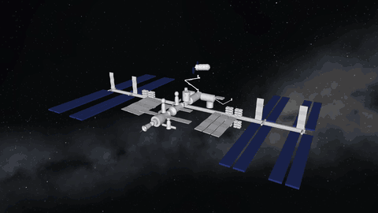
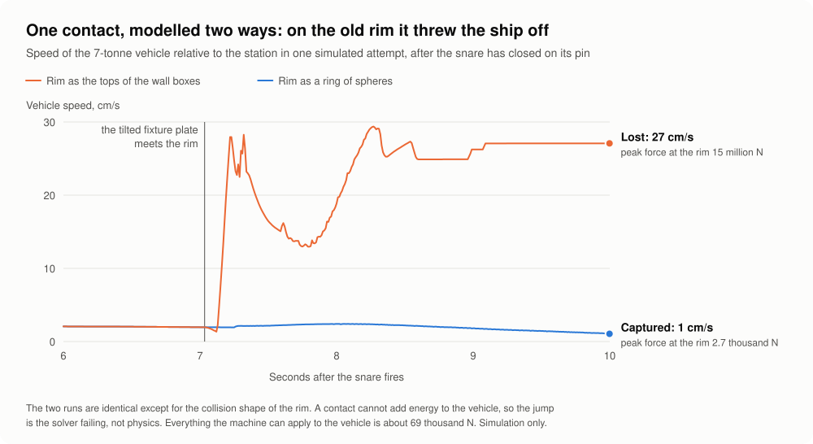
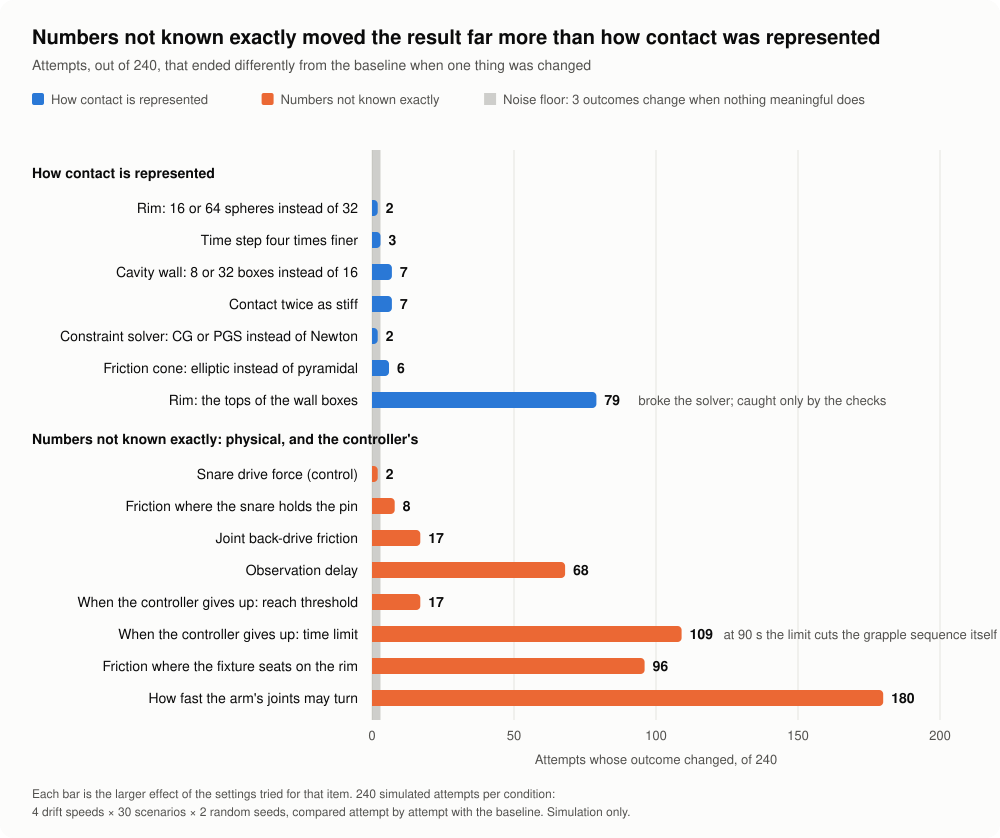

# canadarm-capture

A MuJoCo simulation of a space station manipulator capturing a free-floating cargo vehicle, used to study one question:

**When a contact-rich simulation gives a result, how do you tell whether it is physics or an artefact of how contact was modelled, and which modelling choices is the result most sensitive to?**

[](docs/media/preview.mp4)

A simulated capture at four times real speed. Click for the full-size video.

## Why this scenario

I wanted a contact-rich task with real consequences. Canadarm2 capturing a Cygnus cargo vehicle is one: the target has a mass of seven tonnes and is in free drift, so in microgravity a light contact in the wrong place pushes it away, next to a crewed station.

This project does not solve a problem for the space industry. Canadarm2 performs this capture routinely. I chose it to see whether I could reconstruct a real operation in simulation, and to learn what a contact-rich simulation has to get right. That matters for physical AI: robots are trained and evaluated in simulation, and contact is where simulators are weakest. With gravity removed, contact is nearly the only thing happening, which makes this a clean case for studying it.

## The model

- A 7-joint manipulator with Canadarm2's joint layout, built from the Canadian Space Agency's geometry.
- A 7,000 kg Cygnus with a grapple fixture: a pin on a base plate.
- A latching end effector that snares the pin, retracts to seat the fixture plate against its rim, and latches.
- A resolved-rate controller that tracks the drifting, tumbling vehicle through a sensor model with delay, update rate, and noise.
- A trial harness that runs batches of attempts from a random seed and classifies each outcome: captured, caught but not rigid, lost, missed, out of reach, or timed out.

Every parameter is recorded as sourced, borrowed, or assumed. The [plan](docs/PLAN.md) lists them and the [research notes](docs/RESEARCH.md) give the source for each.


*The scene: the station, the manipulator, and Cygnus at the capture point, 10 m out.*

## Collision geometry is a modelling choice

A physics engine does not collide the detailed meshes it renders. Each body has separate collision geometry, usually a few primitives, and that geometry is the body's surface as far as contact is concerned. If it fills in a hole or rounds off an edge, nothing later in the pipeline restores it.

MuJoCo, like many engines, collides convex shapes only. A convex shape has no dents or hollows, which is not the same as being round: a box is convex. A non-convex object is built as a compound of convex pieces. Each piece is convex; the assembled object does not have to be. The cost is seams between the pieces that the real object does not have.

So the choice of collision geometry is a modelling decision, and a result can depend on it. This project found that out the hard way.

## An artefact that looked like a failure mode

The end effector is hollow, so its collision geometry is a compound: a ring of 16 boxes, overlapping at their edges to leave no gaps. The top faces of those boxes also served as the rim the fixture plate seats on. That was never a deliberate choice.

In a harsh batch, with four times the tested drift and tumble, the model lost 27 of the 30 pins it snared. It read as a physical failure mode, and the obvious explanations were physical ones: residual relative velocity at snare closure, an overpowered snare drive, vehicle momentum absorbed through the snare. Each was tested and ruled out.

Logging contact forces showed the cause. The vehicle keeps tumbling after the snare closes, so the fixture plate meets the rim tilted. Its edge landed where two boxes overlap. The solver received redundant contacts at one location, and when a third arrived with a different normal it returned forces in the millions of newtons and ejected the vehicle faster than it had arrived. A contact cannot add kinetic energy. This was a solver failure, not a capture failure.

<picture>
  <source media="(prefers-color-scheme: dark)" srcset="docs/media/rim-dark.svg">
  
</picture>

*Figure 1. One attempt with the rim's collision geometry built two ways. Nothing else differs.*

Replacing that one surface with a ring of spheres, each giving a single contact with a single normal, took captures from 3 of 30 to 30 of 30. It also reversed an earlier sensitivity result: a controller change that had appeared to double the failure threshold turned out to have no effect at all.

The mistake is an easy one to make. Overlapping the pieces of a compound to close gaps is the natural thing to do. A surface built for one purpose ends up carrying a load it was not designed for. The tests covered a flat seating, not a tilted one. And the outcome label, "lost", was plausible enough to be explained instead of questioned.

## Experiments

Two experiments on the corrected model. Each condition changes one factor and reruns the same 240 attempts (four drift speeds, 30 scenarios each, two seeds), so outcomes are compared attempt by attempt. Including pilots, the project has run more than 10,000 simulated capture attempts.

**Experiment 1: collision geometry.** The same object with different collision geometry: the rim as box tops, or as 16, 32, or 64 spheres; the cavity wall as 8, 16, or 32 boxes. Two numerical settings were varied alongside: a time step four times finer, and doubled contact stiffness.

**Experiment 2: uncertain physical parameters.** Each parameter without a reliable source was treated as a measurement with an uncertainty and moved across a plausible range: the friction coefficient at two separate contacts (0.1 to 0.8), the joint rate limit, joint back-drive friction, and observation delay.

**Guardrail.** Not an experiment: a set of checks that runs on every attempt and flags anything non-physical. An unstable step, a contact force above anything the actuators can apply, a vehicle leaving a contact faster than it arrived, interpenetration beyond 1 cm, a joint driven past its limit. Ideally it never fires. Validated against the original rim, where 50 attempts were known artefacts, it flagged all 50.

<picture>
  <source media="(prefers-color-scheme: dark)" srcset="docs/media/results-dark.svg">
  
</picture>

*Figure 2. Experiment 1 in blue, experiment 2 in orange. Each bar is one factor changed from the baseline, on the same 240 attempts.*

Two conditions calibrate the method. A perturbation with no physical meaning, moving the initial position by 0.001 mm, changes 3 outcomes of 240: that is the noise floor. And the snare drive's force limit, included as a negative control, changes 2.

## Results

1. **With sound collision geometry, the exact choice barely matters.** Sphere count, box count, time step, and contact stiffness each changed at most 7 outcomes of 240, close to the noise floor of 3.
2. **The uncertain physical parameters matter far more.** The joint rate limit changed 180 outcomes; friction where the fixture seats on the rim, 96; observation delay, 68.
3. **One unsound collision geometry mattered as much as real physics.** The original rim changed 79 outcomes, more than all but two of the physical parameters. From the outcome counts alone it was indistinguishable from a real effect. Only the guardrail separated them.
4. **The most influential parameter is an assumed one.** No source gives the joint rate limit. The best-sourced parameter in the model, the rigidizing force, had no effect across its range.
5. **Friction matters at one contact only:** where the tilted fixture plate has to slide flat on the rim, not where the snare holds the pin.

## What transfers to other simulations

- Collision geometry is a modelling choice. Give every load-bearing contact its own simple surface, with no seams where the contact lands.
- Test contacts tilted and off centre, not only in the nominal configuration.
- Run a guardrail on every trial for forces no actuator could produce and for kinetic energy appearing from nowhere. Outcome labels do not reveal them.
- When a failure appears, log contact forces and energy before explaining it.
- Measure the noise floor with a perturbation that should do nothing, so that "no effect" has a size.
- Treat every assumed parameter as a measurement with an uncertainty, and sweep it.
- Keep a negative control.

## Limitations

This is simulation only and has not been validated against flight data. The controller is my own, and the snare is modelled as rigid bars where the real one uses cables. The guardrail still flags two edge cases on the corrected model, both traced to those simplifications; neither changes a capture count. Details are in the [build log](docs/DEVLOG.md).

## More

- [Build log](docs/DEVLOG.md): what was built, what it showed, and what went wrong.
- [Plan](docs/PLAN.md): the question, the experiments, every decision and assumption.
- [Research notes](docs/RESEARCH.md): the real operation, the sources, and where each number comes from.

## Run it

```bash
python3 -m venv .venv
.venv/bin/pip install -e ".[dev]"
.venv/bin/python -m pytest
.venv/bin/python -m capture.batch --n 60 --seed 0
```

That runs with plain stand-in shapes. To use the real 3D models, fetch them once (about 10 MB, from the Canadian Space Agency and NASA):

```bash
.venv/bin/pip install -e ".[assets]"
.venv/bin/python scripts/fetch_assets.py
```

For a starry background in place of plain black (an invented sky, generated locally):

```bash
.venv/bin/python scripts/make_sky.py
```

To watch a capture interactively on macOS (add `--shapes` to see the collision shapes instead of the 3D models):

```bash
.venv/bin/mjpython scripts/view.py
```

To rerun the experiments (two to three hours on eight cores; delete `results/experiments` first to start from nothing):

```bash
.venv/bin/python experiments/run_experiments.py
```

Runs on CPU. Developed on an Apple Silicon Mac with MuJoCo 3.15.

## Credits

3D models of Canadarm2 and Cygnus: Canadian Space Agency. 3D model of the International Space Station: NASA. They are downloaded from the agencies' own sites, not stored here, and used for non-commercial purposes. This project is not associated with or endorsed by the Canadian Space Agency or NASA.

## How this was built

I directed the project and made the design decisions; the code was written with Claude Code. The [build log](docs/DEVLOG.md) records each step, including the approaches that failed.
