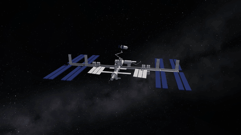
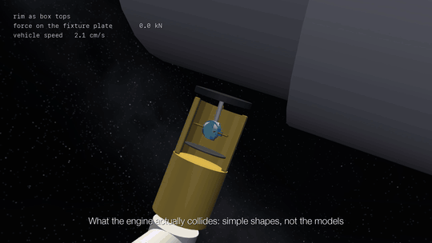

# canadarm-capture

A MuJoCo simulation of a space station arm capturing a free-floating cargo vehicle, built to study one question:

**When a contact-rich simulation gives a result, how do you tell whether it is physics or an artefact of how contact was modelled, and which modelling choices is the result most sensitive to?**

[](docs/media/capture_shapes.mp4)

One simulated capture in 14 seconds: the approach, an x-ray view of the snare closing on the pin, then the collision shapes the solver actually uses while the fixture is pulled in and latched. Click for the full video.

## Why this project

I wanted a contact-rich task with real consequences. Canadarm2 capturing a Cygnus cargo vehicle is one. The target weighs seven tonnes and is in free drift, so in microgravity a light touch in the wrong place pushes it away, next to a crewed station.

Canadarm2 does this routinely. I chose it to see whether I could reconstruct a real operation in simulation, and to learn what a contact-rich simulation has to get right. That matters for physical AI: robots are trained and evaluated in simulation, and contact is where simulators are weakest. With gravity removed, contact is nearly the only thing happening, which makes this a clean case for studying it.

## The model

- **The arm.** A 7-joint manipulator with Canadarm2's joint layout, built from the Canadian Space Agency's geometry.
- **The vehicle.** A 7,000 kg Cygnus carrying a grapple fixture: a pin standing on a flat base plate.
- **The end effector.** The hollow tool on the end of the arm. Three bars inside it, the snare, close around the pin. A carriage then pulls the pin in until the fixture's base plate sits on the end effector's rim, and four latches clamp it there.
- **The controller.** A resolved-rate controller that tracks the drifting, tumbling vehicle, seeing the pin through a sensor model with delay, update rate, and noise.
- **The trial harness.** Runs batches of attempts from a random seed and labels how each one ended: captured, caught but not rigid, lost, missed, out of reach, or timed out.

Every number in the model is recorded as sourced, borrowed, or assumed. The [plan](docs/PLAN.md) lists them and the [research notes](docs/RESEARCH.md) give the source for each.


*The scene: the station, the arm, and Cygnus at the capture point, 10 m out.*

## Collision geometry

A physics engine does not collide the detailed meshes it draws. Each body has separate collision geometry, usually a few simple shapes, and that geometry is the body's surface as far as contact is concerned. If it fills in a hole or rounds off an edge, nothing later in the pipeline puts it back.

MuJoCo, like many engines, collides convex shapes only. Convex means no dents or hollows; it does not mean round, and a box is convex. A hollow object has to be built as a compound of convex pieces. Each piece is convex; the assembled object need not be. The cost is seams between the pieces that the real object does not have.

So collision geometry is a modelling decision, and a result can depend on it. This project measures how much.

## My initial failure

The end effector is hollow, so its collision geometry is a compound: a ring of 16 boxes, made slightly too wide so that they overlap and leave no gaps. The top faces of those boxes also served as the rim the fixture plate seats on. Nobody chose that; it came for free.

In a harsh batch, with four times the tested drift and tumble, the model lost 27 of the 30 pins it snared. It looked like a physical failure, and I wrote three physical explanations for it: the pin was still moving when the snare closed, the snare drive was too strong, the vehicle's momentum was being absorbed through the snare. I tested each and ruled it out.

Logging contact forces showed the cause. The vehicle keeps tumbling after the snare closes, so the fixture plate meets the rim tilted, and its edge landed where two boxes overlap. The solver got two contacts at the same spot, and when a third arrived with a different normal it returned forces in the millions of newtons and threw the vehicle off faster than it had arrived.

<picture>
  <source media="(prefers-color-scheme: dark)" srcset="docs/media/rim-dark.svg">
  
</picture>

*Figure 1. One attempt with the rim's collision geometry built two ways. Nothing else differs.*

[](docs/media/rim_contact.mp4)

*The same attempt as a film, in the view the solver sees. Click for the full video, which shows both rims.*

I replaced that one surface with a ring of spheres, each giving a single contact with a single normal. Captures went from 3 of 30 to 30 of 30. It also undid an earlier result: a controller change that had appeared to double the drift speed the arm could capture at turned out to do nothing at all.

The mistake is an easy one to make. Overlapping the pieces of a compound to close the gaps is the natural thing to do. The problem is that a surface built for one purpose ended up carrying a load it was never meant to.

## Experiments

Two experiments on the corrected model. Each condition changes one factor and reruns the same 240 attempts: four drift speeds, 30 scenarios each, two random seeds. Because the attempts are matched, each condition is scored by how many of the 240 ended differently from the baseline. The drift speeds run from 4 to 16 cm/s, up to five times the 3.1 cm/s the Shuttle end effector was required to capture at, so that failures occur. The baseline captures 110 of 240; nearly all of the rest end with the arm unable to reach a receding vehicle before the controller gives up. Including pilots, the project has run more than 12,000 simulated attempts.

**Experiment 1: collision geometry and the solver.** The same object with different collision geometry: the rim as box tops, or as 16, 32, or 64 spheres; the cavity wall as 8, 16, or 32 boxes. Four simulator settings were varied alongside: a time step four times finer, doubled contact stiffness, the constraint solver (Newton, CG, or PGS), and the friction cone (pyramidal or elliptic).

**Experiment 2: numbers not known exactly.** Every parameter without a reliable source was treated as a measurement with an uncertainty and swept across a plausible range: friction at two separate contacts (0.1 to 0.8), the joint rate limit, joint back-drive friction, observation delay, and the two numbers that decide when the controller gives up: how close to the edge of its reach the arm may get before aborting, and the time limit on an attempt.

**The guardrail.** A set of checks that runs on every attempt and flags anything that is not physics: an unstable step, a contact force above anything the actuators can apply, a vehicle leaving a contact faster than it arrived, shapes overlapping by more than 1 cm, a joint driven past its limit. Ideally it never fires. Tested against the original rim, where 50 attempts were known artefacts, it flagged all 50.

<picture>
  <source media="(prefers-color-scheme: dark)" srcset="docs/media/results-dark.svg">
  
</picture>

*Figure 2. Experiment 1 in blue, experiment 2 in orange. Each bar is one factor changed from the baseline, on the same 240 attempts.*

Two conditions calibrate the method. A change with no physical meaning, moving the starting position by 0.001 mm, flips 3 outcomes of 240: that is the noise floor. And the snare drive's force limit, included as a negative control because it should not matter, flips 2.

## Results

1. **With sound collision geometry, the exact choice barely matters.** Sphere count, box count, time step, contact stiffness, constraint solver, and friction cone each changed at most 7 outcomes of 240, close to the noise floor of 3.
2. **The uncertain physics matters far more.** The joint rate limit changed 180 outcomes; friction where the fixture plate seats on the rim, 96; observation delay, 68.
3. **One unsound collision geometry mattered as much as real physics.** The original rim changed 79 outcomes, more than all but two of the physical parameters. From the outcome counts alone it was indistinguishable from a real effect. Only the guardrail separated them.
4. **The most influential parameter is an assumed one.** No source gives the joint rate limit. The best-sourced parameter in the model, the pull-in force, had no effect across its range.
5. **Friction matters at one contact only:** where the tilted fixture plate has to slide flat on the rim, not where the snare holds the pin.
6. **When the controller gives up decides labels, not captures.** Halving or doubling the reach threshold changed 17 outcomes but not one capture; it only changed which failure an attempt was called. Doubling the time limit to 360 s gained 3 captures, because the attempts that run out of time are ones where the vehicle drifts out of the arm's reach. Halving it to 90 s lost 24, but 18 of those were attempts the limit cut off in the middle of the grapple sequence, which is a flaw in the harness rather than a result.

## What transfers to other simulations

- Collision geometry is a modelling choice. Give every load-bearing contact its own simple surface, with no seams where the contact lands.
- Test contacts tilted and off centre, not only in the nominal configuration.
- Run a guardrail on every trial for forces no actuator could produce and for a body leaving a contact with more speed than it brought. Outcome labels do not reveal them.
- When a failure appears, log contact forces and energy before explaining it.
- Measure the noise floor with a change that should do nothing, so that "no effect" has a size.
- Treat every assumed parameter as a measurement with an uncertainty, and sweep it.
- Keep a negative control.

## Limitations

This is simulation only and has not been validated against flight data. The controller is my own, and the snare is modelled as three rigid bars where the real one uses cables. The guardrail still flags two edge cases on the corrected model, both traced to those simplifications; neither changes a capture count. The harness stops an attempt at its time limit even if the snare has already fired, which only matters at short limits. Details are in the [build log](docs/DEVLOG.md).

## More

- [Build log](docs/DEVLOG.md): what was built, what it showed, and what went wrong.
- [Plan](docs/PLAN.md): the question, the experiments, every decision and assumption.
- [Research notes](docs/RESEARCH.md): the real operation, the sources, and where each number comes from.

## Run it

```bash
python3 -m venv .venv
.venv/bin/pip install -e ".[dev]"
.venv/bin/python -m pytest
.venv/bin/python -m capture.batch --n 60 --seed 0
```

That runs with plain stand-in shapes. To use the real 3D models, fetch them once (about 10 MB, from the Canadian Space Agency and NASA):

```bash
.venv/bin/pip install -e ".[assets]"
.venv/bin/python scripts/fetch_assets.py
```

For a starry background in place of plain black (an invented sky, generated locally):

```bash
.venv/bin/python scripts/make_sky.py
```

To watch a capture interactively on macOS (add `--shapes` to see the collision shapes instead of the 3D models):

```bash
.venv/bin/mjpython scripts/view.py
```

To render the films (needs ffmpeg, the 3D models, and the sky):

```bash
.venv/bin/python scripts/render_film.py shapes
```

To rerun the experiments (about three hours on eight cores; delete `results/experiments` first to start from nothing):

```bash
.venv/bin/python experiments/run_experiments.py
```

Runs on CPU. Developed on an Apple Silicon Mac with MuJoCo 3.15.

## Credits

3D models of Canadarm2 and Cygnus: Canadian Space Agency. 3D model of the International Space Station: NASA. They are downloaded from the agencies' own sites, not stored here, and used for non-commercial purposes. This project is not associated with or endorsed by the Canadian Space Agency or NASA.

## License

The code and documentation in this repository are under the [MIT License](LICENSE). The downloaded 3D models are not covered by it; they remain under the Canadian Space Agency's and NASA's own terms.
