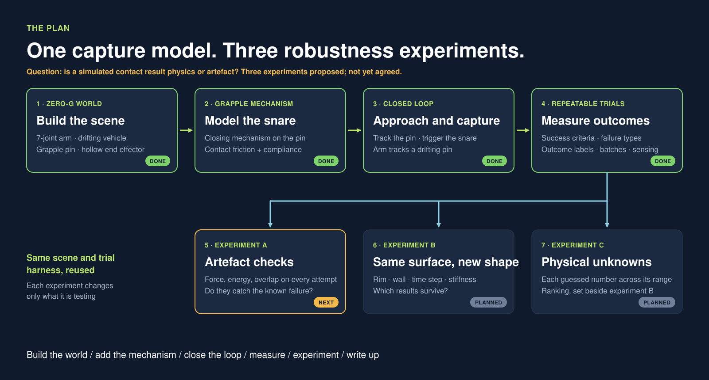
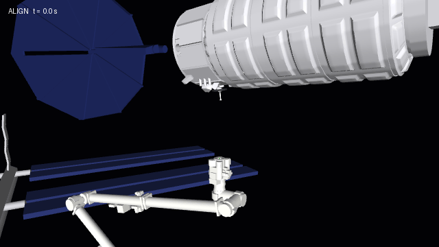

# canadarm-capture

A MuJoCo simulation of a space station arm capturing a free-floating cargo vehicle, built to study how much error the capture tolerates and which physical parameters decide it.

**Status:** in progress. The arm approaches a drifting, tumbling vehicle, inserts the grapple pin, and captures it. A realism pass is under way; the systematic experiments have not been run yet. See the [plan](docs/PLAN.md) and the [build log](docs/DEVLOG.md).







## Run it

```bash
python3 -m venv .venv
.venv/bin/pip install -e ".[dev]"
.venv/bin/python -m pytest
.venv/bin/python scripts/render_approach.py
```

That runs with plain stand-in shapes. To use the real 3D models, fetch them once (about 9 MB, from the Canadian Space Agency's site):

```bash
.venv/bin/pip install -e ".[assets]"
.venv/bin/python scripts/fetch_assets.py
```

To watch a capture interactively on macOS:

```bash
.venv/bin/mjpython scripts/view.py
```

Runs on CPU. Developed on an Apple Silicon Mac with MuJoCo 3.15.

## Scope

Simulation only. Arm joint positions are measured from a simplified 1:100 model; masses, gains, and the snare are approximations. Nothing here is validated against flight data. The [plan](docs/PLAN.md) lists every assumption.

## Credits

3D models of Canadarm2 and Cygnus: Canadian Space Agency. They are downloaded from the agency's site, not stored here, and used for non-commercial purposes. This project is not associated with or endorsed by the Canadian Space Agency or NASA.

## How this was built

I directed the project and made the design decisions; the code was written with Claude Code. The [build log](docs/DEVLOG.md) records each step, including the approaches that failed.
