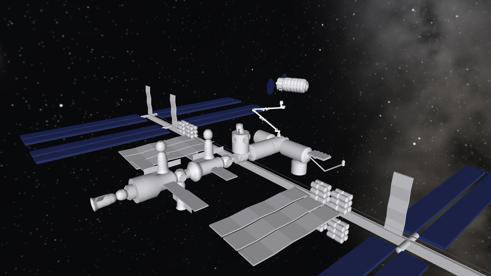

# Build log

Dated entries, newest last. Each one records what was built, why, what the checks showed, and what went wrong.

## 2026-10-09 to 10 · Choosing the project

**Goal.** A physics simulation project for a portfolio aimed at physical AI.

**How the idea changed.**

1. Started as a from-scratch differentiable simulator in PyTorch. Dropped before any code was kept.
2. Refocused on contact-rich manipulation after reading that insertion, grasping, and tactile tasks "depend on accurate contact geometry, friction, compliance, actuator behavior, and tight tolerances".
3. Switched from building an engine to composing existing tools, after reading how NVIDIA's developers assemble simulations from Omniverse libraries, Newton, and MuJoCo.
4. Checked what runs on a MacBook with no NVIDIA GPU:
   - Runs: MuJoCo, Newton (CPU only), OpenUSD, the MuJoCo and URDF to USD converters, the USD and SimReady validators.
   - Does not run: ovrtx, ovphysx, ovstage, ovstream, ovui, Isaac Sim.
5. Rejected a generic arm pick-and-place as too ordinary. Chose to reconstruct a real operation: Canadarm2 capturing a free-floating cargo vehicle.

**Borrowed from the Market Street driving demo.** Two ideas, not the content: plan the work as a visual pipeline, and reuse one world for several experiments that each change one thing.

## 2026-10-10 · Milestone 1: zero-g scene

**Built.**

- `models/capture_base.xml`: a 7-joint arm on a fixed base and a free-floating vehicle with a grapple pin, gravity off.
- `capture/scene.py`: builds the model, adds the hollow end-effector wall, and places the vehicle relative to the end effector.
- `tests/test_scene.py`: six sanity checks.
- `scripts/render_scene.py`: still images.

**Design choices.**

- *Joint layout.* Roll, yaw, pitch at the shoulder, one elbow pitch, then pitch, yaw, roll at the wrist. The three pitch axes are parallel, as on the real arm.
- *Hollow end effector.* MuJoCo collides convex shapes, so the cavity is a ring of 16 boxes around a solid base.
- *Vehicle placement is a function, not a fixed pose.* `place_vehicle(standoff, lateral)` positions the pin relative to wherever the end effector is. Misalignment will later be a perturbation of these arguments, so the experiments get their main knob for free.
- *Position-controlled joints.* Each joint has a position actuator. Gains are invented for now.

**Checks (all pass).**

| Check | Result |
|---|---|
| Gravity is zero; 7 actuated joints plus one free body | Pass |
| Straight-arm reach | 17.6 m |
| Pin placed at the requested offset from the cavity mouth | Exact to 1e-9 m |
| Drifting, tumbling vehicle over 120 s with no contact | Linear momentum constant to 1e-6, angular to 1e-3 (relative) |
| Arm holds the ready pose for 10 s | Within 1e-6 rad |
| Arm follows a 0.1 rad step on every joint | Settles within 5e-3 rad in 30 s |

**What went wrong.** The first build had a 17.2 m arm instead of 17.6 m. The segment lengths had been added up wrongly, and the reach test caught it. Fixed by lengthening each boom from 7.1 m to 7.3 m.

**Not done yet.**

- Shapes are primitives, not real 3D models.
- All dimensions and masses are approximate (listed in `PLAN.md`).
- No snare, no controller, no contact has happened yet.

**Next.** Milestone 2: a closing mechanism inside the end effector that can hold the pin.

## 2026-10-10 · Milestone 2: snare mechanism

**How the real one works.** Three snare cables inside the end effector close around the grapple shaft, then the mechanism pulls the payload in until the interface is rigid. A NASA report gives the design's misalignment tolerance as ±0.1 m lateral and 0.1 m axial.

**Built.**

- A carriage inside the cavity that slides along the approach axis.
- Three snare bars on the carriage, each sliding inward. Open, they form the triangle inscribed in the cavity, so the opening has a 0.1 m inradius, matching the published lateral tolerance. Closed, they meet around the pin.
- One drive for all three bars, tied together with joint constraints, like the rotating ring that drives the real cables.
- `capture/snare.py`: the grapple timing (close over 2 s, pause 2 s, pull in over 2 s).
- `tests/test_snare.py`: eight checks. `scripts/render_capture.py`: stills and an animation.

| Open, pin 6 cm off-centre | Closed and seated |
|---|---|
|  |  |

**Scope of this milestone.** The pin starts already inside the cavity, the vehicle starts at rest, and the arm only holds still. Approaching a moving vehicle is milestone 3.

**What went wrong: the first design did not hold.** Closing and centring worked on the first try, but a 100 N pull drew the pin straight out. The logged joint positions showed why. The pin had a ball tip, and when the carriage pulled the bars against it, the ball's curved surface pushed the bars outward, from 7.6 cm of travel back to 6.6 cm, until the ball passed through.

Two changes fixed it, both with a physical justification:

1. *Flat-backed knob instead of a ball.* A flat face pushes back along the pin axis only, so it cannot spread the bars.
2. *Stiff snare drive.* Force limit raised from 300 N to 1,500 N and gain from 2e4 to 1e5 N/m, with 5 kg of reflected inertia on each bar. The real drive is geared and does not get pushed open.

The three bars also went into one plane. They had been stacked 14 mm apart so they could cross, which loaded the knob off-centre. They do not collide with each other, so one plane works.

**Checks (all pass, 14 in total with milestone 1).**

| Check | Result |
|---|---|
| Open snare, pin 5 cm off-centre | No contact |
| Pin starting 6.3 cm off-centre | Centred to under 5 mm after closing |
| Pull-in | Pin tip at 0.300 m depth: fixture plate seated on the rim |
| 500 N pull-out for 20 s, from three start offsets up to 8.5 cm | Pin does not move (within 2 mm) |
| 2,000 N pull-out (twice the carriage force limit) | Plate unseats by 8 cm to the carriage end stop; pin still caught |
| Snare left open, 100 N pull | Vehicle leaves |

**Side effect.** Two milestone 1 tests assumed seven motors; the model now has nine. Updated the tests.

**Not done yet.**

- Bars are rigid. Real cables wrap and stretch.
- Every snare number (forces, speeds, friction) is invented.
- No angular misalignment has been tested, only lateral.

**Next.** Milestone 3: move the arm to a drifting vehicle and trigger the grapple.

## 2026-10-10 · Milestone 3: approach and capture

**Built.**

- `capture/controller.py`: a three-phase controller.
  1. *Align.* Hold 0.4 m in front of the pin until the end effector is within 1 cm and 1 degree of the pin axis for one second.
  2. *Insert.* Advance along the pin axis at 3 cm/s, still tracking, until the pin tip is 0.25 m inside the cavity.
  3. *Grapple.* Freeze the arm and run the snare sequence from milestone 2.
- `capture/trial.py`: runs one attempt and reports success, the phase reached, the trigger time, and the final pin position and relative speed.
- `scene.py`: the vehicle's start can now be tilted, and given a drift and a tumble.
- `tests/test_capture.py`: five checks. `scripts/render_approach.py`: an animation.

**How the tracking works.** Each step computes where the end-effector mouth should be (on the pin axis, at the commanded standoff, facing the pin) and how fast that point is moving. The error plus the target's own velocity gives a desired end-effector velocity. The damped pseudo-inverse of the arm's Jacobian turns that into joint rates, which are integrated into joint position commands. The arm has 7 joints and the task uses 5 degrees of freedom, because roll about the pin axis is left free.

**One detail that mattered.** The joint servos damp joint velocity, so a steadily moving command lags by the ratio of damping gain to position gain, about one second for the large joints. The controller leads each command by exactly that amount, which turns the servo into one that tracks a velocity reference.

**Success means** the controller finished, the pin tip is within 1 cm of the seated depth and 1 cm of the axis, and the pin is moving less than 2 mm/s relative to the end effector.

**Checks (all pass, 19 in total).**

| Start condition | Result |
|---|---|
| At rest, aligned, 0.6 m away | Captured; snare fired at 27 s, finished at 38 s |
| 5.8 cm off-axis, tilted 2.5 degrees, drifting 7 mm/s, tumbling 0.1 deg/s | Captured; final relative speed 0.2 mm/s |
| Leaving at 30 cm/s | Never grappled; the controller is still approaching at the 60 s limit |
| Tilt and drift setters | Produce exactly the requested pin angle and centre-of-mass velocity |

Each trial takes under one second of computer time for about 38 simulated seconds.

**Observed but not yet tested: a first failure type.** With the vehicle receding at 3 cm/s, the snare fires and catches the pin, but the capture does not seat. At the end the pin is 3 cm short of seated, 3 cm off-axis, and still moving at 5.5 mm/s. The 7-tonne vehicle's momentum keeps pulling on the frozen arm. Call this *caught but not rigid*. Milestone 4 should classify it separately from a clean miss.

**A concern.** With perfect knowledge of the pin and generous joint rates, the controller succeeds on everything short of that case. The experiments will need realistic limits, such as sensing noise and delay and joint rate limits, or the capture envelope will show nothing interesting.

**Not done yet.**

- No sensing model. The controller reads the true state.
- Controller gains, speeds, and limits are invented.
- Only a handful of start conditions tried; no systematic sweep.

**Next.** Milestone 4: a trial harness that samples start conditions, runs many attempts, and classifies each outcome.

## 2026-10-10 · Realism audit and prior work

Before building the trial harness, checked the model against public sources and looked for earlier work on the same problem.

**What matches public data.**

| Item | Public figure | Model |
|---|---|---|
| Arm joints | 7: three shoulder, one elbow, three wrist | Same layout |
| Joint range | ±270 degrees | ±270 degrees |
| Arm length | 17 m (CSA); 17.6 m in other sources | 17.6 m |
| Arm mass | 1,497 kg | 1,500 kg |
| Cygnus diameter | 3.07 m | 3.07 m |
| Cygnus length (Enhanced) | 6.39 m | 6.4 m |
| Cygnus mass | up to 8,050 kg loaded | 7,000 kg |
| Capture method | Vehicle in free drift, thrusters off; three snares close, then rigidize | Same sequence |
| Lateral capture tolerance | ±0.1 m | 0.1 m snare opening |

**What does not.**

- *Appearance.* Everything is cylinders, capsules, and boxes. No NASA or CSA 3D model is used. The station is a grey box.
- *Arm internals.* Segment lengths, mass split, and joint offsets are guesses. The real arm flexes; this one is rigid.
- *Grapple fixture.* Cygnus carries a power and video grapple fixture with a shaft, cam arms, and a target. The model has a rod with a knob, at a guessed position on the hull.
- *Snare.* Rigid bars, not cables. No latches or umbilical after rigidizing. All forces and speeds invented.
- *Control.* Real captures are flown by an operator using camera views of a target. The model is autonomous with perfect knowledge of the pin, and its speeds are unverified.
- *Scenario.* The real capture point is about 10 m from the station. The model starts with the end effector 0.6 m from the pin. No orbital mechanics, lighting, or cameras.
- *Validation.* None against flight or test data.

**Prior work found (three searches, not exhaustive, papers not yet read).**

- Professional and academic simulation of this exact mechanism exists and models the snares as flexible cables: a 2023 multibody dynamics conference paper on real-time simulation of cable-based end effectors, a JAXA study of contact between the snare wires and the HTV grapple fixture, and journal papers on snare-type end-effector cable dynamics.
- An on-orbit operations simulator for Canadarm2 track-and-capture training (arXiv 2002.10594).
- MuJoCo-based space robotics tools: mjorbit (arXiv 2609.08010), SmallSatSim (arXiv 2603.14598), and NASA Johnson's open MuJoCo and ROS 2 tooling.
- No open-source MuJoCo study of Canadarm2 free-flyer capture turned up.

**Takeaway.** The idea is not new and professionals model it at far higher fidelity. What this project can offer is a small, open, reproducible study that runs on a laptop, with its assumptions listed. The cable-snare papers are the obvious place to get realistic parameters and something to compare against.

**Also added.** `scripts/view.py`, an interactive viewer that replays a capture.

## 2026-10-10 · Realism pass, step 1: real 3D models

**Why.** The audit above showed the scene was plain shapes with guessed proportions. Decided to fix realism in three steps before running any experiments: real models, sourced parameters, then the real 10 m starting distance.

**What was available.**

| Source | Model | Used? |
|---|---|---|
| Canadian Space Agency | Canadarm2, two boom halves, 1:100 printable | Yes |
| Canadian Space Agency | Cygnus (Enhanced) body and one solar array, 1:100 printable | Yes |
| NASA 3D Resources | International Space Station, several versions | Not yet |
| NASA 3D Resources | Canadarm2 | Does not exist there (only the Shuttle arm) |

The CSA allows non-commercial reproduction with credit and no implied endorsement. To avoid redistributing the files, `scripts/fetch_assets.py` downloads them from the CSA site into a git-ignored folder and converts them. Without them, the simulation falls back to plain shapes.

**The useful surprise.** Each CSA boom file is made of about 40 separate solid pieces: the boom tube, each joint housing, the end effector, the cameras. That meant two things were possible:

1. Assign pieces to moving links, so the arm articulates with the real model's shapes.
2. Read the joint positions off the pieces. The housings are cylinders, and a cylinder's axis is the joint's axis.

Doing that showed the first arm was wrong in kind, not just in detail. It was a straight chain with every joint on one line. The real arm has offset joints: at each end the pitch housing sticks out sideways from the boom, the yaw housing runs along the boom direction 0.72 m off its centreline, and the roll housing and end effector sit another 0.72 m further out. The two booms lie side by side when folded.

**Rebuilt.**

- `models/capture_base.xml`: the arm, with every joint placed from the measured positions. All arm bodies share one assembly frame and each joint has its own position and axis, which avoids chaining seven hand-computed transforms.
- `capture/geometry.py`: the measured offsets.
- `scene.py`: `build_model(meshes=...)` swaps the meshes in for the stand-in shapes. A new ready pose, found by inverse kinematics.
- Vehicle: collision shape is now two cylinders matching the cargo and service modules, and the grapple pin moved to the service module where the model shows a small fixture.

**Kept simple on purpose.** The meshes are appearance only. Collisions still use the cylinder-and-box shapes, now hidden. A test confirms the masses, inertias, and number of colliding shapes are identical with and without meshes.

**What the new geometry broke, and what that showed.**

1. *The pull-out test failed.* It pulled the vehicle through its centre of mass. With the pin now on the service module, 2.5 m from the centre of mass, a 500 N pull is also a 1,200 N m lever on the fixture. The seated plate, held by a 1,000 N pull-in on a 0.24 m rim, cannot resist that, and the vehicle pried itself loose. This is physically right, and the real end effector has latches for exactly this after pull-in. The test now pulls along the pin, which is what it was meant to check. The lever effect is recorded as a risk for defining a rigid capture.
2. *The momentum check needed a looser tolerance* for linear momentum (1e-4 instead of 1e-6), because the vehicle's body origin is now 2 m from its centre of mass.
3. *The reach test no longer made sense* for a folded zero pose. Replaced with checks on boom length, axis directions, and the ready pose.

The approach and capture tests passed unchanged on the new arm.

**Checks.** 21 pass.

**Not done in this step.**

- The station is still a grey box. NASA's free station model loads, but it is low-detail and untextured, and attaching the arm to it properly needs a real attachment point.
- The solar arrays and the arm's links do not collide with anything.
- Joint positions come from bounding boxes of a simplified printable model, not from engineering drawings.

## 2026-10-10 · Realism pass, step 1 continued: the station

**Built.** NASA's International Space Station model (B) replaces the grey box. `scripts/fetch_assets.py` downloads it from NASA's 3D Resources repository, drops a few stray discs that sit far from the station in the source file, scales it, and splits the solar arrays from the rest so they can be coloured.

**Working out the model.** The file has no units and no module names; its meshes are grouped by material, not by module.

- *Scale.* The truss spans 45.6 model units against a real 108.5 m, giving 2.38. Module radii give 2.1 to 2.3. Used 2.35.
- *Which way is down.* The truss sits on one side of the module axis. On the real station the truss is on the space-facing side, so the opposite side faces Earth.
- *Which end is forward.* Cross-sections along the module axis show where the two side-mounted laboratories (Kibo and Columbus) attach. That is the forward node, Harmony.

**What went wrong.** The first placement had forward and aft swapped. A rendered view was misread for which way it faced, and the arm ended up floating a metre off the Russian segment. The render made the mistake obvious. Fixed by measuring cross-sections instead of reading the picture.

**Placement.** The arm's base sits on the Earth-facing side of Harmony, and the vehicle is captured about 9 m below it. Cygnus is captured roughly 10 m below the station, so the direction is right. The exact fixture the real arm stands on for these captures is not sourced.

**Limits.**

- The model is low-detail and untextured, and its US modules are about 15% narrower than the real ones at this scale.
- The station is scenery. Nothing collides with it.

**Checks.** 21 pass. The station adds no mass or collision shapes.

## 2026-10-10 · Realism pass, step 2: sourced parameters

**Goal.** Replace invented numbers with published ones wherever a source gives them.

**What could be read.**

| Source | Access | Useful? |
|---|---|---|
| Daniell and Sachdev (1982), the design paper for the Shuttle arm's end effector | Full text (scanned PDF with a text layer) | Yes, the main source |
| Arbatani, Kövecses, and Teichmann (2023), real-time simulation of the Canadarm2 end effector's cables | Two-page extended abstract | For method and context |
| Canadian Space Agency comparison table | Web page | Arm speeds and dimensions |
| Uyama et al. (2009), snare contact with the HTV grapple fixture | Abstract only | No numbers |
| Journal paper on snare cable dynamics | Paywalled | Not read |

The 1982 paper is about the Shuttle arm's end effector, not Canadarm2's. Canadarm2's is a larger descendant of the same three-snare design, so its numbers are a guide and not exact values for this model. The full list is in `PLAN.md` under "Sourced values".

**What changed in the model.**

| Parameter | Was (invented) | Now | Basis |
|---|---|---|---|
| Pull-in force limit | 1,000 N | 3,560 N | Rigidize load in the grapple shaft |
| Pull-in time | 2 s | 10 s | Specification: under 20 s |
| Snare closing time | 2 s | 2 s (kept) | Specification: under 3 s |
| Arm during pull-in | Held rigid | Limp, except wrist roll | "Carried out against a limped arm" |
| Arm tip speed | Uncapped | 0.37 m/s cap | Canadarm2's unloaded speed |

**Three things the sourced numbers exposed.**

1. *The pull-in drive was not delivering its force.* A new test applied the paper's 474.5 N m bending moment, at which the real interface must not separate. The model's joint opened by 1.85 degrees. The drive's position gain was too low to reach its own force limit, so the clamp was about 1,050 N instead of 3,560 N. After raising the gain:

   | Bending moment | Tilt of the pin in the end effector |
   |---|---|
   | 474.5 N m (required: no separation) | 0.000° |
   | 800 N m | 0.009° |
   | 1,200 N m | 10° |
   | 1,627 N m (required: at most 3°) | Pin escapes |

   Separation starts near 850 N m, which is the clamp force times the rim radius (3,560 N × 0.24 m). The model meets the first requirement and fails the second, because it has no cam arms or latches.

2. *The controller failed at the specified capture velocity.* The paper allows the payload to be moving at up to 0.031 m/s at capture. With the vehicle receding at that speed, the model missed. The controller stopped the arm the moment the snare fired, and in the 2 s the snare takes to close the pin backed out 6 cm, past the snare. The controller now keeps tracking until the snare has closed. Captures then succeed at 0.031 m/s and 0.06 m/s in all three directions.

3. *There is no reach limit.* At 0.122 m/s receding (the paper's impact design case, not a capture requirement), the arm chases the vehicle to the edge of its workspace and the controller misbehaves. Logged as a risk; the trial harness needs an out-of-reach abort.

**From the 2023 abstract.** The professional approach models each snare as 10 flexible cable elements, with the pin attached to a 20,000 kg payload and a 1 ms time step, and names contact tunnelling under high cable tension as the main difficulty. This model's rigid bars avoid that problem by not being cables, which is also its main limitation.

**Checks.** 25 pass, including three new ones tied to published figures: the bending moment and the capture velocity in three directions.

**Still invented.** Listed in `PLAN.md` under "Assumptions still unsourced". The main ones are link masses, servo gains, snare cable tension and friction, and the absence of arm flexibility.

## 2026-10-10 · Realism pass, step 3: the 10 m capture point

**Goal.** Start each attempt the way a real capture starts: the vehicle holding at the capture point, and the arm reaching out to it.

**What is published.** Cygnus stops at a capture point about 10 m from the station (12 m for the larger Cygnus XL), switches its thrusters off, and drifts while the arm grapples it. Nothing accessible gives the distance the arm waits from the grapple fixture beforehand, or the vehicle's leftover drift rates. The one operations paper on Canadarm2's first free-flyer capture (Lucier and Smith, 2010) is restricted.

**Built.**

- `scene.CAPTURE_DISTANCE = 10.0`: the grapple pin's tip starts 10 m from the surface the arm stands on.
- `scene.HOVER_DISTANCE = 2.0`: the end effector starts 2 m short of the pin. This is an assumption.
- A new ready pose for the hover point, and `reset()` now defaults to this start.
- The controller is unchanged. Its first phase already moves the end effector to 0.4 m from the pin before aligning; it now has 1.6 m to cover first.

**Results.** An attempt now takes 60 simulated seconds (41 s to the snare firing), up from 46 s, and 1.2 s of computer time.

| Start condition | Result |
|---|---|
| At rest, aligned | Captured |
| Off-axis, tilted 2.5°, drifting 7 mm/s, tumbling | Captured |
| Moving at 0.031 m/s: receding, approaching, sideways | Captured |
| Tilted 10° | Captured |
| Tilted 15° and 8 cm off-axis | Captured |
| Tumbling at 0.6°/s | Captured |

**What this confirms.** The concern from milestone 3 stands. Everything succeeds, because the controller knows the pin's exact position and velocity and simply lines the arm up with it. A 15° tilt is no test of the snare when the arm removes the tilt before inserting. The experiments will only be informative once sensing is imperfect: noise, delay, and limits on how fast the arm can follow.

**Also read.** Freer et al. (2020), the Canadarm2 training simulator found earlier, is a Unity tool for studying operator workload. It has no contact physics, and a grapple there means coming within 1 m. It does give ground-control latency of 0.3 to 0.5 s each way, which sets a realistic range for the sensing-delay parameter.

**Realism pass summary.**

| Step | Outcome |
|---|---|
| 1. Real 3D models | Arm, Cygnus, and station from CSA and NASA models; arm rebuilt with offset joints |
| 2. Sourced parameters | Pull-in force, timings, limp arm, speed cap; two faults found and fixed |
| 3. Capture point | Pin starts 10 m from the station; arm starts 2 m short |

**Checks.** 26 pass.

**Next.** Milestone 4, the trial harness. It needs an out-of-reach abort and outcome labels: captured, missed, caught but not rigid, never reached.

## 2026-10-10 · Milestone 4: trial harness

**Goal.** Run many attempts from one command and say how each one ended.

**Built.**

- `capture/trial.py`: five outcome labels, decided from the true final state.

  | Outcome | Meaning |
  |---|---|
  | Captured | Pin seated, on axis, and at rest in the end effector |
  | Caught but not rigid | Snare holds the pin, but it is not seated or is still moving |
  | Missed | Snare fired and the pin is not held |
  | Out of reach | Controller gave up before firing, with the arm at the edge of its workspace |
  | Timed out | Snare never fired in 180 s |

- `capture/controller.py`: an out-of-reach abort. The controller stops when the smallest singular value of the arm's Jacobian drops below 0.15 (it is 0.77 at the ready pose).
- `capture/sensing.py`: the controller now sees the pin only through a sensor with a delay, an update rate, and random error on each reading.
- `capture/batch.py`: a `Scenario` holds everything that defines one attempt. `sample()` draws scenarios from a seed, `run_batch()` spreads them over processes, and the command line prints outcome counts and writes a CSV.

      python -m capture.batch --n 60 --seed 0 --out results/name.csv

**A controller fault found on the way.** With 1 cm and 1 degree of measurement noise the controller hovered in front of the pin until it timed out. It required alignment within 1 cm and 1 degree for a full second, and it tested that against each raw reading. Added a small estimator: between readings the estimate moves with the reported velocity, and each new reading pulls it 20% of the way over. With that, the same conditions capture.

**First batches.** 60 attempts each, same seed, so the three batches share the same offsets and tilts.

| Batch | Vehicle motion | Sensing | Captured | Caught, not rigid | Missed | Out of reach | Timed out |
|---|---|---|---|---|---|---|---|
| Baseline | Drift to 0.031 m/s, tumble to 0.5°/s | Perfect | 60 | 0 | 0 | 0 | 0 |
| Degraded sensing | Same | 0.5 s delay, 10 Hz, 1 cm, 1° | 60 | 0 | 0 | 0 | 0 |
| Wider motion | Drift to 0.122 m/s, tumble to 2°/s | Same as above | 12 | 10 | 12 | 20 | 6 |

All batches used offsets up to 0.1 m and tilts up to 15°, the sourced capture limits.

**What the batches say.**

- Inside the sourced limits the model captures every time, and a half-second delay with centimetre-level noise does not change that. This is consistent with the 1982 requirement that the end effector capture at those limits, though it is not evidence the model is right: the controller has an easy job there.
- At four times the drift and tumble the capture rate falls to 20%, and all five outcomes appear. The largest group is out of reach: the vehicle drifts away faster than the arm can usefully follow.
- Within the wide batch, the vehicles that ended out of reach were mostly receding (median +0.033 m/s along the approach axis) and those caught but not rigid were mostly approaching (median -0.040 m/s).

**Limits of these numbers.**

- Sixty attempts per batch is small. The 20% figure has a wide margin.
- Uniform sampling inside a ball puts most samples near the outer edge, so the wide batch has only four attempts with drift under 0.06 m/s. Experiment A should sweep a grid instead.
- The boundary depends on invented limits: the 0.03 rad/s joint rate cap, the alignment tolerances, and the estimator gain.

**Performance note.** An attempt takes about 1.2 s of computer time on an idle machine. These batches took two to three minutes each because the interactive viewer was open, using more than a full processor core, and the laptop was on battery.

**Checks.** 39 pass. Thirteen are new: outcome labelling, the abort, sensor delay and noise, sampling, and CSV output.

**Next.** Experiment A: sweep drift and tumble on a grid and map the capture envelope.

## 2026-10-10 · Research review

**Why.** Before running experiment A, stopped to gather what is actually known about the operation into one place. A result is only worth reporting if the inputs behind it are understood.

**Built.** `docs/RESEARCH.md`: a plain-language account of the operation, the sources with a note on how far each can be trusted, tables of numbers with where each comes from and what kind of number it is, disagreements between sources, what is still unknown, and what the findings imply for the model.

**How the research was done.** I ran three Perplexity searches. Those surfaced two sources the first pass had missed, and a lead to a third. All three were then opened and read, so the notes can distinguish what has been checked against the source from what has only been reported.

| Source | Found by | Read? | Result |
|---|---|---|---|
| Honda et al. (2014), HTV capture simulation fitted to telemetry | Perplexity | Yes | Every number Perplexity reported matched the paper |
| Chang and Marquez (2018), NASA memo on who does what | Perplexity | Yes | Matched |
| Walker and Vandersluis (1995), the LEE's own design paper | Lead from Perplexity; full text found inside the symposium proceedings on NASA's server | Yes | New: Canadarm2-specific end-effector figures |

**What the 1995 paper adds.** Until now the end-effector numbers came from the Shuttle arm's smaller ancestor. The Canadarm2 values are a 4,893 N rigidize preload (against 3,560 N), four latches adding 64,054 N, a 30 s requirement for the whole capture sequence, and worst-case test conditions that include the force needed to back-drive the arm's joints.

**Two things that change how the model should be described.**

- Honda et al. model the snare wires as rigid rotating rods. This project's rigid bars are a simplification with published precedent, not an outlier.
- The real capture is flown by an astronaut in manual mode, with only the end effector's sequence automated. This model studies an automated capture. That needs saying plainly wherever results are presented.

**Still unknown.** Per-joint rate limits, the vehicle's leftover motion in free drift, and the arm's starting distance from the fixture. None of the accessible literature gives them. They are the three numbers that most affect where capture fails in the model.

**Not changed.** The model. Section 7 of the research notes lists eleven suggested changes; none is applied until reviewed.

## 2026-10-10 · Reframing after a critique

**Input.** I ran the plan and README through Perplexity for a critique against recent work. Its claims about the two 2026 MuJoCo space-robotics tools (mjorbit and SmallSatSim) were checked against the papers, and they held.

**What changed in how the project is described.**

- *The question.* From "how much error can the arm tolerate" to a robustness question: where does capture fail in this simplified model, how, and how much do the answers depend on the model's own assumptions.
- *The gap.* Open MuJoCo tools for contact-rich space robotics exist, so a capture demo is not new. mjorbit closes its docking latch with a conditional weld, and SmallSatSim shows one illustrative docking trial with no arm. What is open is a transparent account of where one capture model's predictions break down.
- *Three envelopes.* Geometric, closed-loop, and operational. This project measures the closed-loop envelope of its own controller and mechanism.
- *Three stages.* Engaged, seated, retained. "Captured" currently means seated.

**Corrections to earlier entries.** These stay as written, with this note:

- Entries above call the tested range "sourced capture limits". It is a range derived from the Shuttle end-effector paper, which states a mechanism requirement and not a limit on a visiting vehicle's motion.
- The milestone 3 and realism step 3 entries say the experiments "show nothing" or will be uninformative with perfect sensing. A baseline that always succeeds is a result. Degraded sensing is added to ask how capture degrades, not to produce failures.
- The 0.3 to 0.5 s latency from Freer et al. is a ground teleoperation figure. Using it as a sensor delay for an automatic controller is an exploratory stress test, not a sourced value.

**Documents changed.** `RESEARCH.md` gained a section on what the project can and cannot claim. `PLAN.md` was rewritten: new question, definitions, an explicit list of what is outside the scope, decisions marked current or superseded, model values grouped by origin, and tighter definitions of the three experiments.

**Not changed.** The model and the code.

## 2026-10-10 · More reading: why capture fails, and what ground tests show

**Input.** A fourth Perplexity search. The main paper (Christidi-Loumpasefski et al., 2024) was read and its numbers matched. The second (Li et al., 2021) sits behind a browser check, so it is recorded as reported.

**Ideas added to the research notes.**

- *Capture is a race.* The mechanism has to finish securing the target before relative motion removes the chance. The model showed this in realism step 2, when a receding pin backed out before the snare shut. That was logged then as a controller fault. It is better understood as an instance of this general structure.
- *Two kinds of uncertainty.* About the encounter (experiment A) and about the model (experiments B and C). Robustness to one says nothing about the other.
- *No single tolerance.* The question is which conditions lead to which outcome, and how stable that is when the assumptions change.
- *Ground tests are not ground truth.* Reported work shows air-bearing supports shifting a manipulator's measured vibration frequency by about 40%.

**Suggested model change added.** Log, for each attempt, how long the pin stayed catchable against how long the snare took to close. Failures can then be explained by their timing margin.

**Not changed.** The model and the code.

## 2026-10-10 · Milestone R4: model update from the research review

**Goal.** Apply the changes listed in section 8 of the research notes.

**Changed in the model.**

| Change | Detail | Basis |
|---|---|---|
| Pull-in force | 3,560 N to 4,893 N | Canadarm2's rigidize preload (Walker and Vandersluis) |
| Latch stage | 64,054 N as four forces pressing the fixture plate onto the rim, ramping over 6 s, only if pull-in seated the fixture | Canadarm2's four latches. Cams and latch geometry are not modelled |
| Sequence | Snare 2 s, pause 2 s, pull-in 10 s, latch 6 s: 20 s | Inside the 30 s requirement |
| Joint friction | 200 N m resisting back-drive on every arm joint | 156 N test side load at 1.3 m |
| Contact friction | 0.6 to 0.3, with a build option to change it | The value Honda et al. chose |
| Roll | Scenarios rotate the vehicle up to 10° about its pin axis | Worst case tested |
| Fixture mount | Optional rotational spring under the grapple fixture | Honda et al. found its stiffness influential. Off by default |
| Shoulder roll | Optional lock | As Honda et al. solve the arm's pose. Off by default |

**Changed in what gets measured.**

- *Stages.* Every attempt records whether the pin was engaged, seated, latched, and retained.
- *Retention check.* After a capture seats and latches, the vehicle is levered sideways with 1,627 N m for 5 s. The joint must hold with under 3° of tilt. "Captured" now requires this. The load is the Shuttle end effector's largest bending case, borrowed because no Canadarm2 figure was found.
- *Timing.* How long after firing the pin stayed catchable, up to the snare's 2 s closing time.
- *A sixth outcome, "lost".* The snare closed on the pin and the pin later escaped. See below.
- *Matched sweeps.* `batch.matched_sweep` varies one quantity with everything else, including the random seed, held fixed.

**Checks on the mechanism.**

| Check | Result |
|---|---|
| Pull-in alone under 474.5 N m (the no-separation requirement) | Holds, no tilt |
| Pull-in alone under 1,627 N m | Gives way, as expected: its limit is about 4,893 N × 0.24 m = 1,170 N m |
| Latched, under 1,627 N m | Holds with under 0.5° of tilt |
| Straight pull of 7,000 N on the snare | Plate unseats to the carriage's end stop; pin still held |
| Straight pull of 8,000 N on the snare | Pin escapes. The load forces the bars apart against their 1,500 N drive |

The last row is a limit of this model. Real snare cables would not open that way. It is the rigid-bar counterpart of the contact tunnelling that Arbatani et al. describe for cables under high tension.

**Batches, rerun on the updated model.** 60 attempts each, same seed as before, now with roll.

| Batch | Captured | Caught, not rigid | Lost | Missed | Out of reach | Timed out |
|---|---|---|---|---|---|---|
| Baseline: drift to 0.031 m/s, tumble to 0.5°/s, perfect sensing | 60 | 0 | 0 | 0 | 0 | 0 |
| Degraded sensing: same motion; 0.5 s delay, 10 Hz, 1 cm, 1° | 60 | 0 | 0 | 0 | 0 | 0 |
| Wider motion: drift to 0.122 m/s, tumble to 2°/s; degraded sensing | 3 | 0 | 27 | 1 | 22 | 7 |

In the first two batches every attempt was engaged, seated, latched, and retained, and the pin stayed catchable for the whole 2 s of closing. The largest tilt in any retention check was 0.007°.

**What happened in the harsh batch.** Before this update it gave 12 captured, 10 caught but not rigid, and 12 missed. Now it gives 3 captured and 27 lost. Eight of the lost attempts, replayed:

- In all eight the snare closed on the pin. The pin left 4 to 9 s after firing, during the pause or the pull-in.
- When the snare finished closing, the pin was still moving at 2.6 to 9.9 cm/s relative to the end effector. The arm stops tracking at that moment.
- The bars were then forced most or all of the way open.

So these are not misses. The snare catches a vehicle that is still moving, the arm stops, and bringing 7 tonnes to rest loads the snare past the roughly 8,000 N at which the bars give way. This is the "capture is a race" idea with a second leg: closing in time is not enough if the relative motion left at that moment is more than the mechanism can absorb.

Why it got worse than before the update is not established. Halving the contact friction is the likeliest cause, since friction on the knob helps keep the bars from spreading, but that is a guess until experiment B varies it alone.

**Caution.** This is a failure regime of this mechanism and controller at four times the tested drift and tumble. It says nothing about Canadarm2, whose snares are cables and whose operator would not attempt a capture in those conditions.

**Checks.** 51 pass.

**Framing.** Also adopted in this commit: the project is described as a case study of an established operation, with no literature gap claimed in advance. Canadarm2 captures vehicles routinely and does not need this simulation.

**Next.** Experiment A: separate, matched sweeps of drift, tumble, offset, and tilt.

## 2026-10-10 · Two questions, and pilots started

**Decision.** A project needs one question to answer, not just a working system to describe. Chosen:

1. *Main.* Which of the model's assumptions decide where the simulated capture fails?
2. *Mechanics.* Why do snared pins get lost?

Neither is claimed to be new. Both are about this model.

**Built for the pilots.**

- Build option for the snare drive's force limit, and a controller option to go limp as soon as the snare closes.
- Batches can now run with a variant of the model or the controller.
- Each attempt records the pin's speed relative to the end effector at the moment the snare finishes closing.
- `experiments/pilot_lost.py`: the 60 harsh scenarios rerun with one change at a time.
- `experiments/pilot_sensitivity.py`: drift swept from 2 to 15 cm/s, repeated with one assumption changed at a time. The failure point is the drift speed where the capture rate crosses 50%.

**Status.** Pilots running when this entry was written. Results to follow in the next entry.

**First two results from the lost-capture pilot.**

| Variant | Captured | Lost | Out of reach | Timed out | Missed |
|---|---|---|---|---|---|
| Baseline | 3 | 27 | 24 | 5 | 1 |
| Arm limp as soon as the snare closes | 7 | 23 | 24 | 5 | 1 |

Going limp earlier recovers four captures. The stiff hold after closing is part of the cause, not most of it. In both, the pin was moving at a median of 5.8 cm/s relative to the end effector when the snare closed.

## 2026-10-10 · Pilot results for the two questions

Both pilots are small: one random seed, 60 attempts per variant in the first and 12 per drift speed in the second. One attempt is 8 percentage points in the second. Treat everything here as a pointer to what the full experiments should test, not as a result.

### Pilot 1: why do snared pins get lost?

The 60 harsh scenarios (drift to 0.122 m/s, tumble to 2°/s, delayed and noisy sensing), rerun with one change at a time. Data: `docs/data/pilot_lost.csv`.

| Variant | Captured | Caught, not rigid | Lost | Missed | Out of reach | Timed out | Pin speed at snare closure (median) |
|---|---|---|---|---|---|---|---|
| Baseline | 3 | 0 | 27 | 1 | 24 | 5 | 5.8 cm/s |
| Arm limp as soon as snare closes | 7 | 0 | 23 | 1 | 24 | 5 | 5.8 cm/s |
| Contact friction 0.6 | 5 | 5 | 19 | 2 | 23 | 6 | 3.7 cm/s |
| Contact friction 0.1 | 2 | 0 | 28 | 1 | 22 | 7 | 6.3 cm/s |
| Snare drive 3,000 N | 3 | 0 | 27 | 1 | 24 | 5 | 5.8 cm/s |
| Snare drive 750 N | 3 | 0 | 27 | 1 | 24 | 5 | 4.8 cm/s |
| Perfect sensing | 5 | 0 | 26 | 0 | 23 | 6 | 0.9 cm/s |
| Limp at close, and perfect sensing | 11 | 0 | 20 | 0 | 23 | 6 | 0.9 cm/s |

**The earlier explanation was wrong on two counts.** The R4 entry said pins were lost because the snare closed on a pin still moving at several centimetres per second relative to the end effector, and that the bars then gave way against their 1,500 N drive.

- *Relative speed at closure is not the cause.* Perfect sensing cut that speed from 5.8 to 0.9 cm/s and the lost count barely moved, from 27 to 26.
- *The drive's force limit is not what gives way.* Halving it or doubling it changed nothing.

**What the data does support.**

- What the arm does after the snare closes matters most. Going limp at once recovers captures in both sensing conditions (3 to 7, and 5 to 11).
- Friction matters some. At 0.6, eight fewer pins are lost, though five of those end caught but not rigid.

**A hypothesis, not yet tested.** The speed that matters is the vehicle's speed relative to the station, not relative to the end effector. While the snare closes, the arm tracks the pin, so their relative speed is small. Then the arm stops, and the vehicle's whole momentum, up to 7,000 kg × 0.12 m/s, has to be absorbed through the snare. A stiff arm stops it too abruptly. A limp arm brakes it only with joint friction, which may be too gentle to finish before the arm holds position again at the end of the sequence. That would explain why going limp helps but does not fix it. The full experiment should record the vehicle's momentum at closure and test it directly.

**An open question about the model.** If the drive does not set the load at which the bars open, something else does. The three bars are tied together by constraints that are slightly soft, and that coupling is the first thing to check. Until then the snare's holding limit is not understood, and the comment in the test and the note in the plan that blamed the drive have been corrected.

### Pilot 2: which assumptions move the failure point?

Drift swept from 2 to 15 cm/s, in each scenario's own direction, with offsets, tilts, roll, and tumble (up to 0.5°/s) matched and sensing perfect. The failure point is the drift speed at which the capture rate crosses 50%. Data: `docs/data/pilot_sensitivity.csv`.

| Variant | Capture rate at 4 cm/s | at 6 cm/s | at 8 cm/s | Failure point | Shift from baseline |
|---|---|---|---|---|---|
| Baseline | 92% | 50% | 8% | 6.0 cm/s | |
| Arm limp as soon as snare closes | 92% | 92% | 92% | 12.0 cm/s | +100% |
| Contact friction 0.6 | 83% | 75% | 17% | 6.9 cm/s | +15% |
| Contact friction 0.1 | 92% | 42% | 8% | 5.7 cm/s | -5% |
| Joint rate cap halved | 75% | 33% | 8% | 5.2 cm/s | -13% |
| Joint rate cap doubled | 92% | 50% | 8% | 6.0 cm/s | 0 |
| Observation delay 0.5 s | 92% | 17% | 8% | 5.1 cm/s | -15% |
| Observation delay 1.0 s | 83% | 17% | 0% | 5.0 cm/s | -17% |
| Snare drive 750 N | 92% | 50% | 8% | 6.0 cm/s | 0 |
| Snare drive 3,000 N | 92% | 50% | 8% | 6.0 cm/s | 0 |
| Estimator gain 0.05 | 92% | 50% | 8% | 6.0 cm/s | 0 |
| Estimator gain 1.0 | 92% | 50% | 8% | 6.0 cm/s | 0 |

Every variant captured all 12 at 2 cm/s.

**What it suggests.**

- One assumption dominates: what the arm does once the snare has closed. Going limp at once doubles the failure point. That is a control choice, not a physical parameter.
- Friction, the joint rate cap, and observation delay each move it by 5 to 17%. With 12 attempts per speed these shifts are one or two attempts wide and could be noise.
- The snare drive's force and the estimator gain move it not at all. The estimator result is expected, since this pilot has no measurement noise for it to smooth. The snare result is the same puzzle as in pilot 1.
- The baseline failure point, 6 cm/s, is about twice the 3.1 cm/s the Shuttle end effector was required to handle.

**The two pilots agree.** Both point at the same place: the seconds after the snare closes, when the arm has to take up the vehicle's motion.

**What a full experiment needs that the pilots lacked.**

- More scenarios per point, and more than one seed, so that a 10% shift can be told from noise.
- Finer steps in drift between 4 and 8 cm/s, where the baseline falls from 92% to 8%.
- The vehicle's momentum at closure recorded for every attempt.
- The estimator gain tested with noisy sensing, where it can matter.
- The snare's holding limit understood first.

**Not changed.** The model's defaults. The limp-at-close option stays off until decided.

## 2026-10-10 · Follow-up: what gives way in the snare

**Why this entry exists.** I had two Claude Code sessions open on this repository at once. The entry above came out of the one that started the pilots. This one comes from the second, which checked the snare-drive puzzle while the sensitivity pilot ran. Both sets of notes went into the same commit, with the results written up twice. This entry now keeps only what the one above does not have.

**The question.** The entry above leaves open what sets the load at which the bars open, since the drive's force limit does not, and names the bar coupling as the first thing to check.

**Check 1: is the option applied?** Yes. The compiled model's drive force range is ±750, ±1,500, or ±3,000 N as asked.

**Check 2: replays.** `experiments/replay_lost.py` reruns single harsh scenarios and logs the three bars and the drive after the snare has closed. Scenarios 0, 4, 5, and 6, each at 1,500 and 3,000 N. All eight runs ended lost.

| Scenario | Speed at close | Bars pushed back to (1,500 N / 3,000 N) | Largest gap between bars (1,500 N / 3,000 N) |
|---|---|---|---|
| 0 | 9.9 cm/s | -1.4 cm / -4.0 cm | 1.5 cm / 2.4 cm |
| 4 | 2.8 cm/s | -1.1 cm / -0.9 cm | 7.7 cm / 7.6 cm |
| 5 | 8.1 cm/s | -0.7 cm / -1.0 cm | 0.4 cm / 1.0 cm |
| 6 | 7.0 cm/s | -1.0 cm / +0.2 cm | 0.4 cm / 0.9 cm |

Bar position runs from 0 (fully open, the joint's stop) to 8 cm (fully closed). The bars were at 6.7 to 7.4 cm when the snare finished closing.

- The drive sat at its force limit in all eight runs.
- In seven of eight the bars went *past* their open stop, by up to 4 cm. The stop is a soft joint limit and gave way.
- In scenario 4 one bar stayed at 6.3 cm while the other two were pushed fully open. The coupling between bars gave way, as the entry above suspected. In the other three scenarios the bars stayed within 2.4 cm of each other and opened together.

**What this establishes.** The load on the snare in these attempts is well beyond what the drive holds at either setting, which is why doubling it changes nothing. The coupling slips in some attempts but not most, so it is one route out, not the explanation. The soft open stop is a second model artefact. Real cables on a rotating ring can do neither.

**Not established.** How large the load is, and whether it comes from the stiff arm, the vehicle's tumble, or the pull-in drive hauling a moving vehicle. Contact forces at the pin were not logged. Four scenarios is a look, not a measurement.

**Two more gaps in the sensitivity pilot.**

- It saves capture rates only, not how failures divide between lost, out of reach, and the rest. So it cannot say whether the 6 cm/s boundary is the lost-pin mechanism or the arm running out of reach.
- Doubling the joint rate cap changed nothing, and that is unexplained. Either the cap is not what limits the arm at these speeds or the 0.37 m/s tip speed cap binds first. Not checked.

**What went wrong.**

- Two sessions edited the same files without knowing about each other, and the commit mixed their work. The plan's risk and assumption notes on the soft stop and coupling come from this session; the test comment and the entry above from the other.
- The project notes said a missing table meant a pilot had not finished and should be rerun. The pilots were still running. Checking for the process first avoided a duplicate run, and the notes now say to check.
- The viewer was open for the first part of the pilot run, against the project's own rule.

**Checks.** 51 pass.

**Not changed.** The model and the controller.

## 2026-10-11 · Load pilot: lost pins are a contact blow-up, not an overloaded snare

**Goal.** Measure what loads the snare after it closes, and test the hypothesis from the pilot entry: that the vehicle's momentum relative to the station has to be absorbed through the snare, and that this is what pulls the pin out.

**Built.**

- `run_trial` takes an `after_step` callback, called once each step is complete. Contact forces can only be read correctly at that point. Nothing else in the model or controller changed.
- `experiments/pilot_load.py`: the 60 harsh scenarios, with the default arm and with the arm limp from snare closure. From the moment the snare fires it logs the vehicle's speed and spin relative to the station, the force the snare bars put on the pin, the force between the vehicle and the rest of the end effector, and the tilt between the pin and the end effector's axis. One row per attempt in which the snare fired, in `docs/data/pilot_load.csv`.

**Result.** Outcome counts match the lost-capture pilot: 3 captured and 27 lost by default, 7 and 23 with the limp arm.

| | Default arm, captured (3) | Default arm, lost (27) | Limp arm, captured (7) | Limp arm, lost (23) |
|---|---|---|---|---|
| Vehicle speed at closure | 6.8 to 7.9 cm/s | 2.0 to 11.8 cm/s | 6.2 to 8.1 cm/s | 2.0 to 11.8 cm/s |
| Vehicle spin at closure | 1.2 to 1.8°/s | 0.9 to 2.6°/s | 0.9 to 1.8°/s | 1.3 to 2.6°/s |
| Tilt at closure | under 0.6° | under 3.6°, median 0.7° | under 0.6° | under 3.6°, median 0.7° |
| Largest tilt while held | 3.4 to 4.7° | 29 to 47° | 0.8 to 4.5° | 31 to 47° |
| Tilt when the end effector first pushed on the vehicle with over 10 kN | (only the latches, at 0°) | 5.2 to 11.8°, median 6.2° | (only the latches, at 0°) | 5.2 to 12.0°, median 6.2° |
| Time of that, after firing | | 3.8 to 9.7 s, median 6.3 s | | 3.6 to 9.8 s, median 6.1 s |
| Largest bar force before that | 4.9 kN | 0.5 to 27.8 kN, median 5.6 kN | 4.9 kN | 0.5 to 7.9 kN, median 6.5 kN |
| Largest force from the rest of the end effector | 69 kN (latches) | 73 kN to 2.3 MN, median 0.6 MN | 69 kN (latches) | 86 kN to 1.5 MN, median 0.8 MN |
| Vehicle speed when the pin left, or at the end | under 0.7 cm/s | 14 to 134 cm/s, median 56 cm/s | under 1.1 cm/s | 9 to 121 cm/s, median 78 cm/s |
| Vehicle spin then | under 0.1°/s | 17 to 199°/s, median 71°/s | under 0.1°/s | 25 to 291°/s, median 103°/s |

Every one of the 50 lost attempts follows the same sequence:

1. The snare closes on the pin with the pin nearly on axis.
2. The vehicle goes on tumbling. Three bars around a round pin hold a point; they do not stop rotation. The tilt between the pin and the end effector grows at about the tumble rate.
3. After a median of 6 s the tilt reaches 5 to 12° and the fixture's plate meets the end effector's rim.
4. Within a few hundredths of a second the contact force there reaches hundreds of kilonewtons to meganewtons, and the vehicle leaves at several times the speed and tens of times the spin it arrived with. The bars are forced open on the way out.

Every captured attempt stayed under 4.7° of tilt, and its spin was down to 0.3°/s by the time the latches came on.

**Step 4 is not physics.** A contact cannot give a vehicle more kinetic energy than it had. In scenario 4, logged step by step:

- The plate touches the rim at 7.00 s after firing. For 0.1 s the contact behaves: penetration grows smoothly to 3.3 mm and the force to 578 N on each of two wall boxes.
- At 7.108 s a third wall box comes into contact at 0.04 mm of penetration. On that step the forces go to 245 kN, 245 kN, and 485 kN. Penetration did not jump.
- Sixteen milliseconds later they are 1.5 to 1.8 MN at under 5 mm of penetration, and the model's kinetic energy has gone from 15 J to 116 J.

The first two wall boxes report identical penetration and force throughout. The cavity wall is a ring of 16 boxes that overlap at their edges, so the plate's edge meets two of them at the same place. That is the likely cause: redundant contacts that the solver cannot resolve once a third arrives at a different angle. It is not established. The solver's handling of a thin cylinder against boxes is the other candidate.

**What this does to earlier explanations.**

- *The momentum hypothesis (pilot entry) is not supported.* Before the plate meets the rim the bars carry a median of 5.6 kN, most of it the pull-in drive's own 4.9 kN, and the vehicle's speed has barely changed (median 7.3 cm/s at closure, 5.2 cm/s when the plate meets the rim). The snare is not being overloaded by momentum in that time. One attempt reached 27.8 kN first and may be an exception.
- *"Forced apart against the drive" (R4 entry) and the soft stop and coupling (follow-up entry) are consequences.* The bars open because the blow-up drives the pin through them.
- *Why the limp arm helps is now a guess with a mechanism.* A limp arm can be turned by the tumbling vehicle, so the tilt grows more slowly. Four more attempts stay under 5° until the latches hold. Not tested directly.
- *Why friction 0.6 helped is open again.*

**What it means for the two questions.**

- Question 2 has a first answer, for this model: snared pins are lost when tumble tilts the fixture plate into the rim before pull-in has seated it, and what happens next is a numerical failure. What a sound contact would do at that point, lever the fixture straight or pry the pin out, is exactly the question, and this model cannot answer it yet.
- Question 1's pilot numbers need rereading. The harsh batch tumbles at up to 2°/s. The sensitivity pilot tumbles at up to 0.5°/s and saved no failure types, so whether its 6 cm/s boundary is this same blow-up is unknown.
- The "lost" counts in every batch so far, including the R4 table, count this artefact.

**What went wrong.** Three explanations for lost pins were written down before anyone logged a contact force. The second session checked the bars and the drive and stopped there. The energy check that settles it took one replay.

**Checks.** 51 pass. The 62 rows are 31 fired attempts per variant; the other 29 scenarios never fire the snare.

**Not done, and not decided.**

- No fix. Candidates: build the cavity wall so that the plate meets one surface at a time, or give the rim a single collision ring; then rerun this pilot and see what a well-behaved contact does.
- The sensitivity pilot has not been rerun with failure types and tilt saved.
- Whether real grapple fixtures can be tilted into the rim at all at these tumble rates has not been researched. Canadarm2's end effector was tested to 15° of tilt at capture (Walker and Vandersluis), which is larger than the 5 to 12° at which this model's plate meets its rim. That suggests the modelled rim or plate geometry is tighter than the real one. The plate radius, rim radius, and pin length here are not sourced.

## 2026-10-11 · A rim the plate can sit on, and the lost captures disappear

**Goal.** Fix the plate-on-rim contact found in the load pilot, and see what a well-behaved contact does with a tilted plate.

**Changed in the model.**

- The fixture plate now seats on a ring of 32 spheres set into the rim, their tops in the mouth plane where the box tops were. Each sphere gives the plate one contact with one normal. The plate collides with the spheres and nothing else; nothing else collides with the spheres. The wall boxes still form the cavity for the pin and knob.
- `scene.build_model(rim="boxes")` builds the rim as it was, to reproduce the failure.
- Seated depth, masses, and every other contact are unchanged. The 51 existing checks pass without edits.

**Same attempt, before and after.** Scenario 4 of the harsh batch, vehicle tumbling at 1.9°/s:

| | Box-top rim | Sphere rim |
|---|---|---|
| Plate meets the rim | 7.0 s after firing, at 11° of tilt | between 7.5 and 8.0 s, at about 12° |
| Largest force at the rim before latching | 7 MN | about 3 kN, sampled every half second |
| Tilt afterwards | grows to 33° as the vehicle is thrown off | falls to 0° by 12.5 s as pull-in levers the plate flat |
| Vehicle speed | 2 to 25 cm/s in a tenth of a second | stays under 2.5 cm/s, at rest by 20 s |
| Outcome | lost | captured |

**Load pilot, rerun** (`docs/data/pilot_load.csv`; the earlier table is now `pilot_load_box_rim.csv`).

| | Box-top rim | Sphere rim |
|---|---|---|
| Default arm: captured / lost, of 30 snared | 3 / 27 | 30 / 0 |
| Limp arm: captured / lost, of 30 snared | 7 / 23 | 30 / 0 |
| Largest tilt while held, captured attempts | up to 4.7° | 3.7 to 14.1°, median 10° |
| Largest bar force | up to 147 kN | 4.9 to 5.0 kN, the pull-in drive's own limit |
| Largest rim force | up to 2.3 MN | 69 kN, the latches |

One attempt in each variant fires and misses, as before.

**Lost-capture pilot, rerun** (`docs/data/pilot_lost.csv`; earlier table `pilot_lost_box_rim.csv`). The same 60 harsh scenarios.

| Variant | Captured | Caught, not rigid | Lost | Missed | Out of reach | Timed out |
|---|---|---|---|---|---|---|
| Baseline | 30 | 0 | 0 | 1 | 24 | 5 |
| Arm limp as soon as the snare closes | 30 | 0 | 0 | 1 | 24 | 5 |
| Contact friction 0.6 | 10 | 20 | 0 | 1 | 23 | 6 |
| Contact friction 0.1 | 30 | 0 | 0 | 1 | 22 | 7 |
| Snare drive 3,000 N | 30 | 0 | 0 | 1 | 24 | 5 |
| Snare drive 750 N | 30 | 0 | 0 | 1 | 24 | 5 |
| Perfect sensing | 30 | 1 | 0 | 0 | 23 | 6 |
| Limp at close + perfect sensing | 29 | 2 | 0 | 0 | 23 | 6 |

**What this shows.**

- *The "lost" outcome was the artefact, all of it.* No variant loses a pin now. Question 2 as asked ("why do snared pins get lost?") has its answer: in this model they were lost to a contact the solver could not resolve.
- *The limp-at-close effect in this batch was the artefact too.* It is 30 against 30 now. The pilot's headline, that going limp doubles the failure point, came from the sensitivity pilot, which has not been rerun. It should be assumed gone until it is.
- *In this batch the capture no longer fails after the snare closes.* Every attempt that snares the pin holds it. What stops the other half is earlier: 24 give up at the edge of the arm's reach and 5 never fire. That is the arm's workspace and the controller's abort rule, at four times the tested drift.
- *A new, physical-looking sensitivity appeared.* At friction 0.6, twenty of thirty snared attempts end caught but not rigid. The likely reason is that the tilted plate has to slide on the rim to come flat, and at 0.6 it sticks. Not checked. At 0.3 and 0.1 it slides. This is the kind of result the project was set up to find, and it sits on a surrogate (flat plate on a ring of spheres) for the cams that do this job on the real fixture.
- *Tilt of up to 14° at the rim is levered out by a 4.9 kN pull-in.* Whether that is believable depends on plate, rim, and pin dimensions, none of which are sourced. See the research log for the same date.

**Research.** A second search for fixture geometry found no dimensions. It did find the station programme's vehicle requirements (SSP 50235, 2000 baseline): hold the grapple box for 5 minutes, and stay in it for up to 90 s of free drift. Recorded in the research notes with the documents that would have the geometry.

**Checks.** 52 pass. The new one replays scenario 4 and requires that the plate tilts past 10°, that the vehicle's speed never exceeds 1.5 times its speed at firing, and that the attempt ends captured.

**What went wrong or is weak.**

- The sensitivity pilot has not been rerun. The laptop was on battery at 34% and it needs about 20 minutes on every core. Its published table (`pilot_sensitivity_box_rim.csv`) describes the old rim. The script now also saves how attempts failed at each speed.
- Why the solver failed on the box tops is still a likely cause, not a demonstrated one. Replacing the surface made the failure go away, which is consistent with redundant contacts and does not prove it.
- Other contacts in the model still use cylinders against overlapping boxes, the knob inside the cavity in particular. None misbehaved in these 480 attempts. That is not a guarantee.
- A ring of spheres is slightly bumpy. A plate sliding round the rim crosses 32 small gaps.
- Every batch table before this entry, including R4's, was produced with the old rim.

**Not done.** Experiments A and B are still undesigned. The plan's two questions need restating, since the second is answered and the first has lost its main result.

## 2026-10-11 · Stepping back: what the project is for

**Why.** I stopped the work to ask what problem this solves, why this industry, whether the real operation is already solved, and how any of it connects to physical AI and physics simulation. The plan's two questions had become specific to this model, and the work had been running ahead of my own understanding of it.

**Answers, in short.**

- It solves no problem for the space industry. Canadarm2 does this routinely with a forgiving mechanism, a cooperative target, and a trained operator.
- The scenario was chosen because it is harder and more consequential than a desk arm and a mug, and because zero gravity leaves contact as nearly the only thing going on.
- The most useful thing produced so far is not about capture. It is the lost-pin episode: a convincing failure mode, three wrong physical explanations, and a cause that was numerical.

**The new question.** When a contact-rich simulation gives a result, how do you tell whether it is physics or an artefact of how contact was modelled, and which modelling choices is the result most sensitive to? It replaces the two earlier questions, which are kept in the plan for the record.

**How the work changes.** I build, and use Claude Code to explain and review. The plan now has a map of five layers (world, contact, machine, brain, experiment) and the agreed path is to go through them one at a time, starting with contact. The sensitivity pilot waits until I can say what it measures.

**Uncertainty.** This is the same idea as uncertainty in a physics lab, and it is now in the plan: a guessed number is a measurement with a wide uncertainty, and a sensitivity run is how its effect on the result is found.

**Also built: a sky.** The background was flat black. `scripts/make_sky.py` paints a cube map of about 30,000 stars, a band of glow with dust lanes, and four faint galaxies, and the scene uses it when the file exists. It is invented, not a map of the real sky, and changes nothing in the physics. Checked by rendering wide views across the cube's edges and corners: the band is continuous. A real camera exposed for sunlit hardware would show few stars or none, and the Earth, which fills much of the real view, is not drawn.

**Checks.** 52 pass.

## 2026-10-11 · Collision shapes, and whose notes these are

**What I learned.** I had not known that a simulator collides simple hidden shapes, not the models it draws. Following that up, in conversation and with Perplexity:

- The collision shape is the object's surface as far as physics is concerned. If it fills a hole or rounds an edge, the simulation gets that interaction wrong and nothing later corrects it.
- Convex means no dents or hollows, not round. A box is convex.
- There is a middle ground between one blob and a full mesh: several convex pieces fixed together. That is what this model's end effector is.
- The part that clicked for me: each piece has to be convex, but the object built from them does not. An open box made of five flat slabs is hollow, because no slab fills the inside. My end effector's cavity is the same idea, 16 boxes in a ring.
- What that costs is seams. Where two pieces meet there is an edge or an overlap the real object does not have. My lost-pin bug was at one: the plate touched two overlapping wall boxes in the same place.
- Needing convex shapes is a property of particular engines and algorithms, MuJoCo among them. It is not a law of physics.
- Tools that split a mesh into convex pieces automatically can fill in the openings that make an object work. A 2022 paper (CoACD) is about that problem.

The details and sources are in the research notes, section 2 and section 3. The MuJoCo and CoACD points were checked against the sources; the rest is reported.

**Why it matters for this project.** It is the question in small. This model has changed a collision shape three times, and each time the result changed: the cavity built from boxes, the pin's tip from a ball to a disc, the rim from box tops to spheres. An experiment that builds the same surface several ways is now a candidate in the plan.

**Notes added to the plan.**

- Weight and mass: in orbit nothing has weight, so every contact force comes from a motor or from motion. Mass still decides how much a push changes an object's motion.
- Three habits from my first-year uncertainty guide that apply here, and one finding from its section on significant figures: several of the model's sourced values are round numbers in pounds and feet converted to metric (4,893 N is 1,100 lbf; 64,054 N is 14,400 lbf), so they are good to two or three figures.

**Voice.** These documents had been written from the assistant's point of view, referring to me by name. They are now my notes: plain where they are just notes, first person where they are mine. Work I did not do by hand is described without an "I". The README says how the project was built.

**Not changed.** The model and the code.

## 2026-10-11 · Sensitivity pilot rerun, a viewer bug, and three proposed experiments

**Sensitivity pilot on the fixed model.** Same design as before: drift swept from 2 to 15 cm/s over 12 matched scenarios, perfect sensing, one assumption changed at a time. Captures out of 12 at each speed. `docs/data/pilot_sensitivity.csv`, with failure types in `pilot_sensitivity_outcomes.csv`; the earlier table is `pilot_sensitivity_box_rim.csv`.

| Variant | 2 | 4 | 6 | 8 | 10 | 12 | 15 cm/s | Fails at (old rim) | Fails at (fixed) | How it fails now |
|---|---|---|---|---|---|---|---|---|---|---|
| Baseline | 12 | 12 | 12 | 12 | 10 | 9 | 6 | 6.0 | 15 or above | Out of reach |
| Arm limp as soon as the snare closes | 12 | 12 | 12 | 12 | 10 | 9 | 6 | 12.0 | 15 or above | Identical to baseline |
| Contact friction 0.6 | 12 | 9 | 6 | 5 | 4 | 3 | 0 | 6.9 | 6.0 | Caught, not rigid |
| Contact friction 0.1 | 12 | 12 | 12 | 12 | 10 | 9 | 6 | 5.7 | 15 or above | Identical to baseline |
| Joint rate cap halved | 12 | 10 | 9 | 6 | 2 | 3 | 0 | 5.2 | 8.0 | Timed out, out of reach |
| Joint rate cap doubled | 12 | 12 | 12 | 12 | 12 | 11 | 11 | 6.0 | above 15 | Almost nothing fails |
| Observation delay 0.5 s | 12 | 12 | 12 | 12 | 10 | 8 | 4 | 5.1 | 13.5 | |
| Observation delay 1.0 s | 12 | 12 | 9 | 5 | 4 | 3 | 1 | 5.0 | 7.5 | Missed |
| Snare drive 750 N or 3,000 N | 12 | 12 | 12 | 12 | 10 | 9 | 6 | 6.0 | 15 or above | Identical to baseline |
| Estimator gain 0.05 or 1.0 | 12 | 12 | 12 | 12 | 10 | 9 | 6 | 6.0 | 15 or above | Identical to baseline |

"Fails at" is the drift speed where captures fall through half. One attempt is 8 points.

**The ranking turned over.**

- On the old rim one change dominated: the arm going limp at closure doubled the failure point, and everything else was within noise. On the fixed model that change does nothing at all.
- What matters now is different for each parameter, and each fails in its own way. A slower arm runs out of time and reach. Stale observations make the snare miss. High friction leaves the fixture caught but not pulled rigid.
- Doubling the joint rate cap was "unexplained, no effect" before. It now removes nearly every failure. The artefact had been hiding it.
- The baseline's limit moved from 6 cm/s to about 15 (exactly half are captured there), about five times the 3.1 cm/s the Shuttle end effector was required to handle.

So the sensitivity ranking itself was an artefact of one collision surface. That is the project's question, answered once by accident.

Still a pilot: 12 attempts a point, one seed, tumble only up to 0.5 deg/s. The estimator-gain rows still test nothing, because sensing is perfect in this sweep.

**A viewer bug.** Opening the viewer with the new `--shapes` option produced MuJoCo's "simulation is unstable" warning. The viewer's own loop never cleared the applied forces between steps, so once the latches came on, their 64 kN was added again every step. It dates from the latch stage (R4). Batches and tests step through `run_trial`, which does clear them, so no result was affected. Fixed with one line, and the same scenario now finishes with no warning. A result that looked like the model's behaviour was an artefact of how it was being run.

**Also built.** `scripts/view.py --shapes` shows the collision shapes in place of the 3D models.

**Three experiments proposed.** Written up in the plan, not yet agreed:

- A, artefact checks on every attempt, tested against the old rim's 50 known failures.
- B, the same surface represented different ways (rim, cavity wall, time step, contact stiffness), to see which results survive.
- C, each guessed physical number moved across a plausible range.

The comparison that matters is B against C: does the choice of representation move the result as much as the physical unknowns do?

**Checks.** 52 pass.
