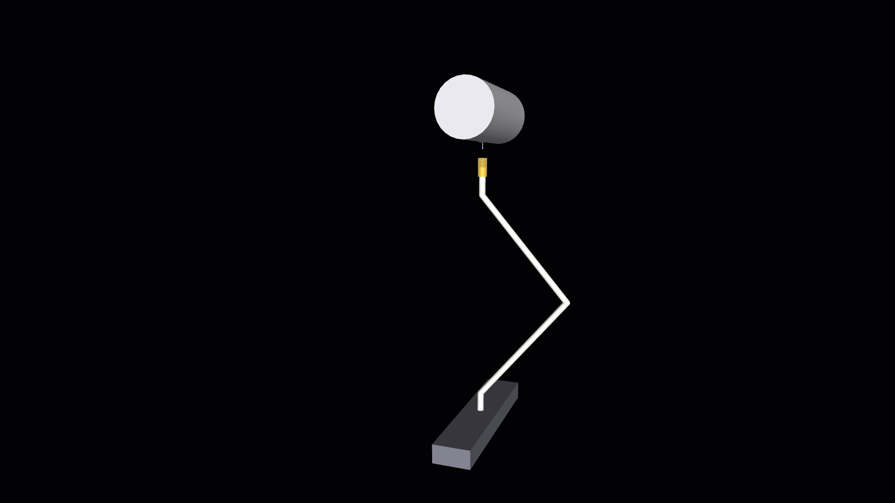
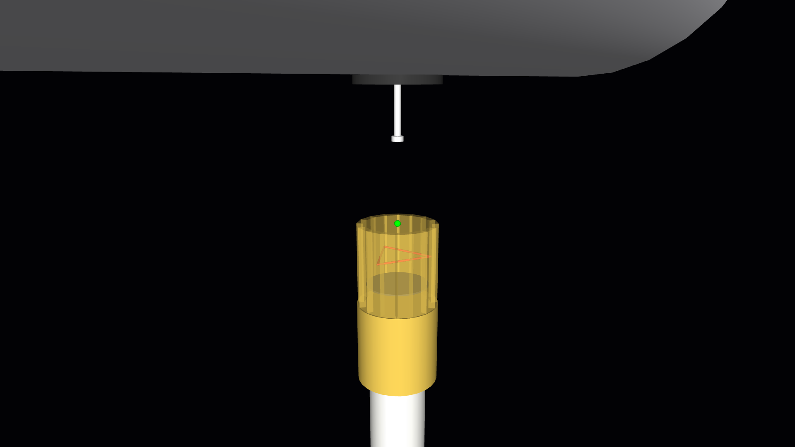
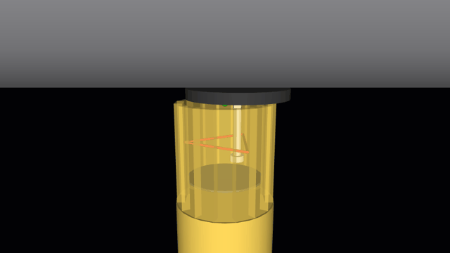
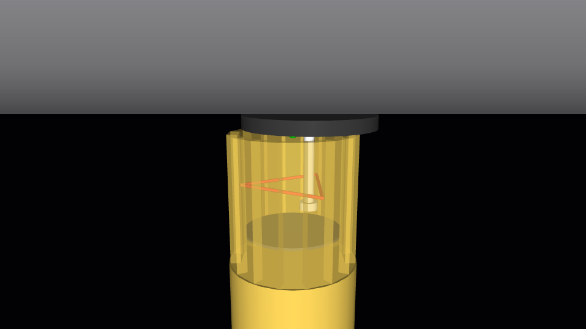
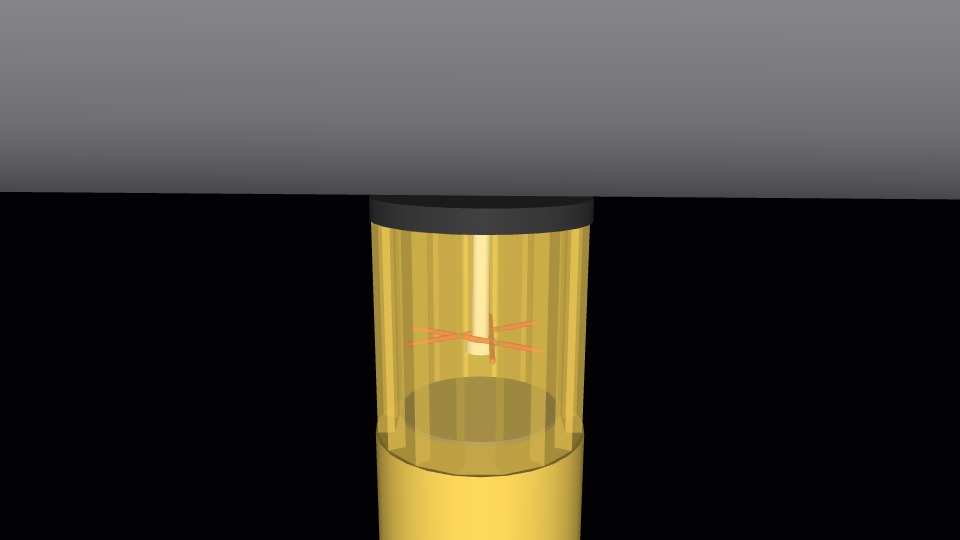

# Build log

Dated entries, newest last. Each one records what was built, why, what the checks showed, and what went wrong.

## 2026-10-09 to 10 · Choosing the project

**Goal.** A physics simulation project for a portfolio aimed at physical AI.

**How the idea changed.**

1. Started as a from-scratch differentiable simulator in PyTorch. Dropped before any code was kept.
2. Refocused on contact-rich manipulation after reading that insertion, grasping, and tactile tasks "depend on accurate contact geometry, friction, compliance, actuator behavior, and tight tolerances".
3. Switched from building an engine to composing existing tools, after reading how NVIDIA's developers assemble simulations from Omniverse libraries, Newton, and MuJoCo.
4. Checked what runs on a MacBook with no NVIDIA GPU:
   - Runs: MuJoCo, Newton (CPU only), OpenUSD, the MuJoCo and URDF to USD converters, the USD and SimReady validators.
   - Does not run: ovrtx, ovphysx, ovstage, ovstream, ovui, Isaac Sim.
5. Rejected a generic arm pick-and-place as too ordinary. Chose to reconstruct a real operation: Canadarm2 capturing a free-floating cargo vehicle.

**Borrowed from the Market Street driving demo.** Two ideas, not the content: plan the work as a visual pipeline, and reuse one world for several experiments that each change one thing.

## 2026-10-10 · Milestone 1: zero-g scene

**Built.**

- `models/capture_base.xml`: a 7-joint arm on a fixed base and a free-floating vehicle with a grapple pin, gravity off.
- `capture/scene.py`: builds the model, adds the hollow end-effector wall, and places the vehicle relative to the end effector.
- `tests/test_scene.py`: six sanity checks.
- `scripts/render_scene.py`: still images.

**Design choices.**

- *Joint layout.* Roll, yaw, pitch at the shoulder, one elbow pitch, then pitch, yaw, roll at the wrist. The three pitch axes are parallel, as on the real arm.
- *Hollow end effector.* MuJoCo collides convex shapes, so the cavity is a ring of 16 boxes around a solid base.
- *Vehicle placement is a function, not a fixed pose.* `place_vehicle(standoff, lateral)` positions the pin relative to wherever the end effector is. Misalignment will later be a perturbation of these arguments, so the experiments get their main knob for free.
- *Position-controlled joints.* Each joint has a position actuator. Gains are invented for now.

**Checks (all pass).**

| Check | Result |
|---|---|
| Gravity is zero; 7 actuated joints plus one free body | Pass |
| Straight-arm reach | 17.6 m |
| Pin placed at the requested offset from the cavity mouth | Exact to 1e-9 m |
| Drifting, tumbling vehicle over 120 s with no contact | Linear momentum constant to 1e-6, angular to 1e-3 (relative) |
| Arm holds the ready pose for 10 s | Within 1e-6 rad |
| Arm follows a 0.1 rad step on every joint | Settles within 5e-3 rad in 30 s |

**What went wrong.** The first build had a 17.2 m arm instead of 17.6 m. I had mis-added the segment lengths, and the reach test caught it. Fixed by lengthening each boom from 7.1 m to 7.3 m.

**Not done yet.**

- Shapes are primitives, not real 3D models.
- All dimensions and masses are approximate (listed in `PLAN.md`).
- No snare, no controller, no contact has happened yet.

**Next.** Milestone 2: a closing mechanism inside the end effector that can hold the pin.

## 2026-10-10 · Milestone 2: snare mechanism

**How the real one works.** Three snare cables inside the end effector close around the grapple shaft, then the mechanism pulls the payload in until the interface is rigid. A NASA report gives the design's misalignment tolerance as ±0.1 m lateral and 0.1 m axial.

**Built.**

- A carriage inside the cavity that slides along the approach axis.
- Three snare bars on the carriage, each sliding inward. Open, they form the triangle inscribed in the cavity, so the opening has a 0.1 m inradius, matching the published lateral tolerance. Closed, they meet around the pin.
- One drive for all three bars, tied together with joint constraints, like the rotating ring that drives the real cables.
- `capture/snare.py`: the grapple timing (close over 2 s, pause 2 s, pull in over 2 s).
- `tests/test_snare.py`: eight checks. `scripts/render_capture.py`: stills and an animation.

| Open, pin 6 cm off-centre | Closed and seated |
|---|---|
|  |  |

**Scope of this milestone.** The pin starts already inside the cavity, the vehicle starts at rest, and the arm only holds still. Approaching a moving vehicle is milestone 3.

**What went wrong: the first design did not hold.** Closing and centring worked on the first try, but a 100 N pull drew the pin straight out. The logged joint positions showed why. The pin had a ball tip, and when the carriage pulled the bars against it, the ball's curved surface pushed the bars outward, from 7.6 cm of travel back to 6.6 cm, until the ball passed through.

Two changes fixed it, both with a physical justification:

1. *Flat-backed knob instead of a ball.* A flat face pushes back along the pin axis only, so it cannot spread the bars.
2. *Stiff snare drive.* Force limit raised from 300 N to 1,500 N and gain from 2e4 to 1e5 N/m, with 5 kg of reflected inertia on each bar. The real drive is geared and does not get pushed open.

I also put the three bars in one plane. They had been stacked 14 mm apart so they could cross, which loaded the knob off-centre. They do not collide with each other, so one plane works.

**Checks (all pass, 14 in total with milestone 1).**

| Check | Result |
|---|---|
| Open snare, pin 5 cm off-centre | No contact |
| Pin starting 6.3 cm off-centre | Centred to under 5 mm after closing |
| Pull-in | Pin tip at 0.300 m depth: fixture plate seated on the rim |
| 500 N pull-out for 20 s, from three start offsets up to 8.5 cm | Pin does not move (within 2 mm) |
| 2,000 N pull-out (twice the carriage force limit) | Plate unseats by 8 cm to the carriage end stop; pin still caught |
| Snare left open, 100 N pull | Vehicle leaves |

**Side effect.** Two milestone 1 tests assumed seven motors; the model now has nine. Updated the tests.

**Not done yet.**

- Bars are rigid. Real cables wrap and stretch.
- Every snare number (forces, speeds, friction) is invented.
- No angular misalignment has been tested, only lateral.

**Next.** Milestone 3: move the arm to a drifting vehicle and trigger the grapple.
